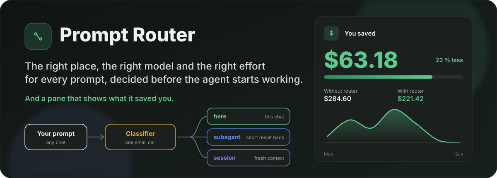
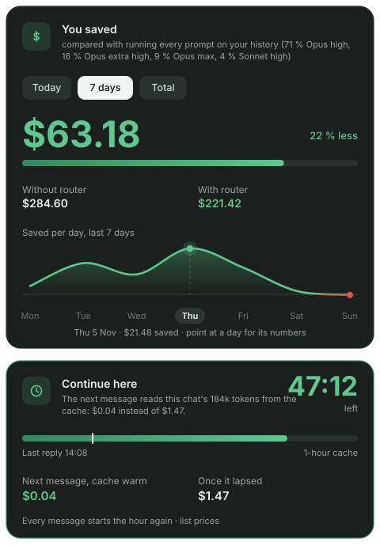
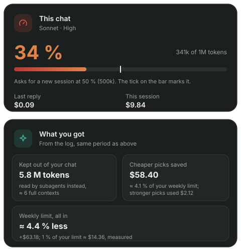
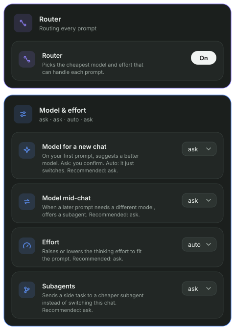
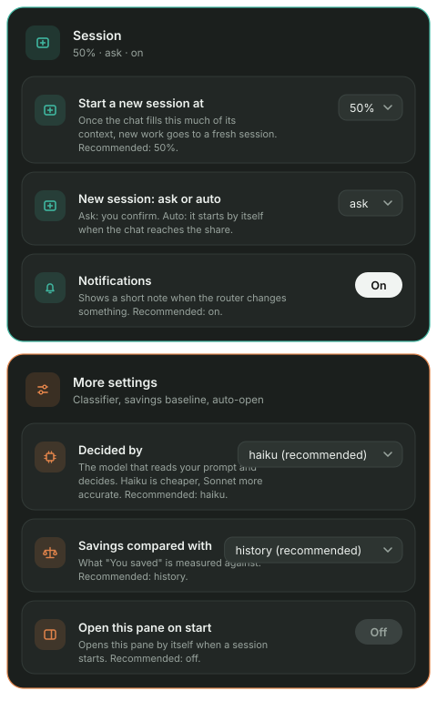
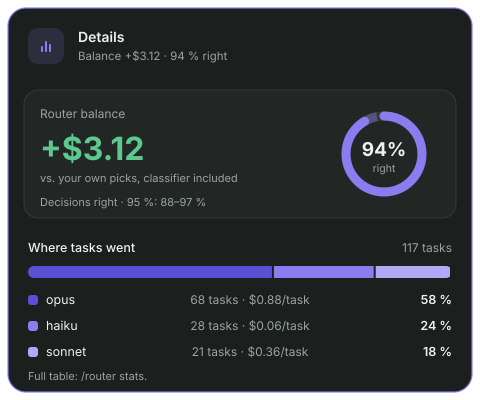

<div align="center">



<h1>🧭 Claude Prompt Router</h1>

**Routes every prompt to the right place, model and effort, and shows you what that saved.**


<sub>Claude Code mod · OpenCode plugin · local only · MIT</sub>

[Why](#why) •
[Features](#features) •
[The pane](#the-pane) •
[Install](#install) •
[Quick start](#quick-start) •
[Commands](#commands) •
[Settings](#settings) •
[Savings](#savings) •
[Platforms](#platforms) •
[FAQ](#faq) •
[Development](#development) •
[What's new](#whats-new)

</div>

---

<a id="why"></a>
## 💡 Why

> Every reply in a long chat re-reads the whole context. Opus on a rename burns money. Haiku on a race condition burns time.

Claude Prompt Router makes **one small classifier call per prompt** (none for a plain `yes` or `option 2`). Before any work starts, it tells the agent where the prompt belongs and which model and effort it needs. You stay in control: every change is offered first, unless you tell it to just do it.

<table>
<tr>
<td width="25%" align="center">🔀<br><b>Where</b><br><sub>this chat, a subagent or a new session</sub></td>
<td width="25%" align="center">🧠<br><b>Model</b><br><sub>small, mid, big, or the top one for the rare hardest cases</sub></td>
<td width="25%" align="center">🎚️<br><b>Effort</b><br><sub>low, medium, high, xhigh, max</sub></td>
<td width="25%" align="center">🙋<br><b>You decide</b><br><sub>a question by default, or <code>auto</code></sub></td>
</tr>
</table>

<a id="features"></a>
## ✨ Features

- 🔀 **Routes every prompt**: keep, here, subagent or new session ([how it decides](#decisions)).
- 🧠 **Picks the model and effort** on a new chat's first prompt and the effort on later ones.
- 🛡️ **Never breaks your cache**: the chat's model is not switched mid-chat. A prompt that fits another model is offered as a subagent on it.
- 📏 **Watches the context**: once the chat is full to a share you choose, new work is offered a fresh session (or starts one by itself).
- 💰 **Shows what it saved** in dollars, per day, against what you ran before the router ([how it is counted](#savings)).
- ⏱️ **Cache countdown**: how long the chat's prompt cache stays warm and what the next message costs warm or cold.
- 🪟 **A pane beside the chat** with all of the above and every setting, so you rarely need a config file.
- ⚡ **No call for plain replies** (`yes`, `ok`, `option 2`, a number, a letter, in five languages).
- 🔒 **Local only**: the stats log holds no prompt text, replies or file names.
- 🧩 **Your own rules** in plain text, and a [live eval](#development) to tune them.

<a id="the-pane"></a>
## 🪟 The pane

> [!NOTE]
> The pictures below use **sample data**, not real usage. They are generated by [`docs/images/generate.mjs`](docs/images/generate.mjs).

Open it with `/router panel` (or let it open by itself with `openPane`). In the desktop app it is a pane beside the chat; in a terminal you get a text version. It updates after every reply. Top to bottom, the cards are:

### You saved and Cache



- **You saved**: the headline number for **Today**, **7 days** or **Total**, with **Without router** against **With router** and how many percent less that is. The line says what it is compared with (here: *every prompt on your history*, with the mix of models and efforts you ran before).
- **Saved per day**: a smooth line over the last 7 days. Point at a day for its numbers. A day in the minus turns **red** with a minus sign: there the router cost more than it saved. With too little data the card says so.
- **Continue here** (the Cache card): a countdown of the chat's **1-hour cache** and when the last reply was. It shows what **the next message** costs if the cache is warm and what it costs **once it lapsed**. After the cache lapses it turns into *Reply soon to keep the cache* and then *No cache yet*. Every message starts the hour again.

### This chat and What you got



- **This chat**: the model and effort, how full the context is (`275k of 1M tokens`), and a tick on the bar where the router will ask for a new session. **Last reply** and **This session** are what they cost at list prices.
- **What you got**, from the log, same period as the overview:
  - **Kept out of your chat**: tokens read by subagents instead of your chat, as a number of full contexts.
  - **Cheaper picks saved**: dollars saved by cheaper models, as a share of your weekly limit, and what stronger picks cost.
  - **Weekly limit, all in**: how much less of the weekly limit you used, measured from the app's own rate limit (`1 % of your limit ≈ $…, measured`).

### Settings

All of them are in the pane, each with one line on what it does and which value is recommended. Grouped:

 

| Group | Settings |
| --- | --- |
| **Router** | On / off for the whole router |
| **Model & effort** | **Model for a new chat**, **Model mid-chat**, **Effort**, **Subagents** (each `ask`, `auto` or `off`) |
| **Session** | **Start a new session at** (10 to 100 % of the context), **New session: ask or auto**, **Notifications** |
| **More settings** | **Decided by** (the classifier), **Savings compared with**, **Open this pane on start** |

### Details



- **Router balance**: the strict per-task balance (negative in red), against your own picks, classifier included. See [how the balance is worked out](#balance).
- **Decisions right**: the share of routed tasks without a failure, as a ring with its **95 % range** (Wilson interval) drawn as a lighter stretch of the track.
- **Where tasks went**: tasks per model, with the cost per task and the share.

> [!NOTE]
> The pane is Claude Code only. OpenCode gets a text table through the `router_stats` tool.

<a id="install"></a>
## 📦 Install

| Agent | Install | Then |
| --- | --- | --- |
| 🟠 **Claude Code** | `/plugin marketplace add Viktorooos/claude-prompt-router`<br>`/plugin install prompt-router@prompt-router` | Open a new chat |
| 🔵 **OpenCode** | `git clone https://github.com/Viktorooos/claude-prompt-router.git`<br>`node claude-prompt-router/adapters/opencode/install.ts` | Restart OpenCode |

Details and uninstall: [Claude Code](#claude-code), [OpenCode](#opencode).

<a id="quick-start"></a>
## 🚀 Quick start

1. Install it (above) and open a **new chat**. Options are read when a session starts.
2. Type as usual. When a prompt does not belong in this chat, the agent asks before it starts:

   ```
   ╭─ Prompt Router ─────────────────────────────────────────────────────╮
   │ Where should this go? It is an unrelated feature, so a fresh        │
   │ session fits.                                                       │
   │                                                                     │
   │   › New session (Sonnet · medium)      ← recommended                │
   │     Subagent (Haiku · low)                                          │
   │     Do it here (Low)                                                │
   │     Do it here (keep Medium)                                        │
   ╰─────────────────────────────────────────────────────────────────────╯
   ```

3. Type `/router panel` to open the pane and see what it saves.
4. Optional: set `project` (what your chats are about) so the classifier fits your work, and add your [own rules](#your-own-rules).

When a prompt stays here but needs more or less thinking, you get **Switch / Keep as is**. With `effortDetection: auto` it just switches and tells you:

```
Effort: Low (was Medium), small follow-up to the last fix
```

On a new chat's **first prompt** it also checks the model: Opus picked for a rename? Haiku for debugging? It offers the switch (or makes it, with `firstChatDetection: auto`).

<a id="commands"></a>
## ⌨️ Commands

Claude Code:

| Command | What it does |
| --- | --- |
| `/router` | Status, this chat's model and effort, every option with its value and where it came from |
| `/router panel` (or `pane`) | Open the pane beside the chat |
| `/router stats` | The savings as a text table (Today / 7 days / Total) and a page with a graph of the last 30 days |
| `/router off` | Turn the router off (remembered across sessions) |
| `/router on` | Turn it back on |

The mod also registers two tools for the agent: `switch` (changes this chat's model or effort, because Claude Code's session tools refuse the chat they run in) and `test` (runs the [live eval](#development)).

In OpenCode: `/router`, `/router off`, `/router on`, and the `router_stats` and `router_session` tools. See [OpenCode](#opencode).

## 🧩 How it works


The classifier sees:
- the new prompt (only the text you typed),
- the chat's first and last few prompts, and the last earlier prompt,
- the start of the agent's last reply,
- the current model, effort and context size.

Plain replies pass through with **no classifier call**: up to five words that are each a yes / no / ok / thanks / go on word (English, Czech, Spanish, German, French: `yes, go on`, `ano, pokračuj`, `sí, hazlo`, `díky`), `option 2` / `možnost 2`, a number or a single letter. A reply with any word of its own (`yes, but use Postgres`) or a re-work sign (`still wrong`) goes to the classifier as usual. Slash commands and prompts where nothing needs to change pass through untouched too.

> [!NOTE]
> **Architecture.** [`core/router.ts`](plugins/prompt-router/core/router.ts) holds the shared logic: the classifier prompt, parsing its reply, the routing rules. [`hooks/register.tsx`](plugins/prompt-router/hooks/register.tsx) (Claude Code) and [`adapters/opencode/`](adapters/opencode) only wire it to each platform.

<a id="decisions"></a>
### Decisions

| | When |
| --- | --- |
| **keep** | An approval or an answer to the agent's question. Nothing changes. |
| **here** | Builds on what this chat already read or changed, is trivial, or the chat is still small. |
| **subagent** | A self-contained search, read, build or test run whose short result is needed here. |
| **session** | Unrelated to this chat, or long mechanical work better done with a fresh context. In a chat over **60k tokens**, even a trivial unrelated task goes here. |

**Here on another model.** The chat's model is set only on its first prompt. Later, switching it would break the prompt cache and the new model would read the whole context again at full price. So when a prompt belongs here but fits a stronger or a cheaper model, the router asks: **Subagent (model · effort)**, which gets what it needs from the chat and returns a short result, or **Stay here**, where only the effort is judged again. With `midChatModelDetection: off` it only judges the effort.

### Models

The router thinks in four tiers. Each platform maps them to its own models. In OpenCode the mapping is yours: any provider, mixed if you like.

| Tier (OpenCode) | Claude Code | For | Claude price (in / out per 1M) | OpenCode default |
| --- | --- | --- | --- | --- |
| **`light`** | Haiku | Running, reading, searching, short answers | $0.10 / $0.50 | `anthropic/claude-haiku-5-5` |
| **`standard`** | Sonnet | Mechanical edits by an existing pattern | $2 / $10 | `anthropic/claude-sonnet-5-5` |
| **`strong`** | Opus | New logic, debugging, review, anything risky | $4 / $20 | `anthropic/claude-opus-5-5` |
| **`top`** | Fable | Only where Opus at high effort is likely not enough | $10 / $50 | `anthropic/claude-fable-5-1` |

<a id="fable"></a>
<details>
<summary><b>When Fable is offered</b></summary>

Fable is rare on purpose.

- ✅ A new architecture across several layers with no clear solution.
- ✅ A hard concurrency or security problem whose reach is unknown.
- ✅ A bug two fixes already failed to solve.
- ✅ A deep analysis where a wrong conclusion costs a lot.
- ❌ Never for an everyday feature (however big), a code review, payments or a migration with a known approach.

It is offered only when your platform has it: in Claude Code your model picker lists it; in OpenCode a provider lists `models.fable`, or the chat runs on it.

</details>

### Effort

| | For |
| --- | --- |
| **low** | Simple work |
| **medium** | The default |
| **high** | Where a hidden mistake costs money, data or trust |
| **xhigh** | Long critical work you hand off (overnight, over the weekend) |
| **max** | Only when you ask for the maximum, or a one-off irreversible step with a very high cost of a mistake (production data, a live security incident) |

Words like *important*, *carefully* or *do it properly* never raise it beyond **high** on their own.

<a id="settings"></a>
## ⚙️ Settings

The same keys on every platform (except where marked). Each feature has its own switch. Set them in the [pane](#settings-in-the-pane), in `/plugin` → prompt-router → Configure, or in the config file. The **Recommended** column is what the pane marks as recommended; the first value in *Values* is the default.

| Option | Values (default first) | Recommended | What it does |
| --- | --- | --- | --- |
| `project` | text (empty: a software project) | set it | What your chats are about, in a few words. |
| `rules` | text (empty) | | Your own routing rules. They win over the built-in ones. |
| `language` | `auto`, or a language name | | The language of the reason and of the questions. `auto` uses each prompt's language. |
| `classifier` | `sonnet`, `haiku`, `opus`; in OpenCode `standard`, `light`, `strong` | `haiku` | The model that makes the call. Haiku is cheaper, Sonnet more accurate, Opus the most accurate and expensive. |
| `effortDetection` | `ask`, `auto`, `off` | `ask` | The effort for a prompt that stays here. `ask`: a question first. `auto`: just switch. `off`: never touch it. |
| `firstChatDetection` | `ask`, `auto`, `off` | `ask` | The model on a new chat's first prompt. |
| `midChatModelDetection` | `ask`, `auto`, `off` | `ask` | A later prompt that stays here but fits another model. `ask`: offer Subagent or Stay here. `auto`: the agent decides itself and tells you in one sentence; the chat's model never changes. |
| `subagentSuggestions` | `ask`, `auto`, `off` | `ask` | `ask`: offer a subagent for a self-contained task. `auto` (Claude Code): the subagent starts right away and the agent says so. `off`: the prompt stays here. In OpenCode `auto` works like `ask`. |
| `sessionSuggestions` | `ask`, `auto`, `off` | `ask` | `ask`: offer a new session for an unrelated task or a full chat. `auto` (desktop app): the new session starts by itself, with no question. `off`: the prompt stays here. |
| `newSessionAt` | `50%`, `10%` … `100%` in steps of 10 (`off` for old configs) | `50%` | Once the chat holds this share of its model's context window, any prompt that would stay here is offered as a new session: every reply re-reads the whole context. In Claude Code the window is cut to where the chat compacts (`CLAUDE_CODE_AUTO_COMPACT_WINDOW`, `CLAUDE_AUTOCOMPACT_PCT_OVERRIDE`). In the pane, "off" is `sessionSuggestions: off`. |
| `notifications` | `on`, `off` | `on` | A toast after an automatic change, and a footer label in Claude Code. |
| `compareWith` | `opus-medium`, any `<model>-<effort>` (`haiku`, `sonnet`, `opus`, `fable` × `low` … `max`), `first`, `history` (Claude Code) | `history` | What the [savings](#savings) are compared with. OpenCode always uses `first`. |
| `stats` | `on`, `off` | | Claude Code. `on`: note each decision and each turn's token use in a local file for the [savings](#savings). |
| `openPane` | `off`, `on` | `off` | Claude Code. `on`: the pane opens by itself when a session starts (from 144 terminal columns, 110 once you have opened it with `/router panel`), or else on your first prompt. |

`/router` shows the value of every option and where it came from: set, an old key, or the default.

<a id="settings-in-the-pane"></a>
> [!TIP]
> **Settings in the pane** save into the installed mod's options (or `settings.json`). Options are read when a session starts, so a change applies to a **new chat**.

> [!NOTE]
> **Old names still work.** Before 0.8.0 there were two keys. `effortMode` is now `effortDetection`. `modelMode` is now `firstChatDetection`, and `modelMode: off` also turns off `midChatModelDetection`. An old key counts only when the new key is missing. `/router` tells you to rename it.

> [!TIP]
> Want no questions about effort or model at all? Set `effortDetection` and `firstChatDetection` to `auto` and `midChatModelDetection` to `off`. "Where should this go?" is still asked; to stop it, set `subagentSuggestions` and `sessionSuggestions` to `off`.

### Your own rules

`rules` is plain text appended to the classifier's prompt, and it wins over the built-in rules. Write it like a note to a colleague:

```
Database migrations: opus, high.
Translating finished Compose screens to SwiftUI: sonnet, medium.
Payments, vouchers, auth: opus, high.
Copy changes on the marketing site: haiku, low.
```

Name the tier either way: `haiku`/`sonnet`/`opus`/`fable` or `light`/`standard`/`strong`/`top`. OpenCode maps it to your models.

### Accuracy and cost

Last live eval: **123 cases**, including the Fable / xhigh / max boundaries. `test/cases.json` now has 132; the 9 newer cases have not been run live yet. How to run it: [Development](#development).

| Classifier | Result |
| --- | --- |
| Sonnet, 3 runs | ✅ 369 / 369 |
| Opus | ✅ 123 / 123 |
| Haiku | ⚠️ 114 / 123 (none of the misses raised a tier) |

One classifier call per prompt (none for a plain reply): low effort, at most 150 output tokens, on the model you pick in `classifier`. That is a fraction of a cent per prompt. The savings come from not running a 200k-token chat on a question that needed a fresh one.

<a id="savings"></a>
## 💰 Savings

An **estimate** from list prices, kept honest. The pane's **You saved**, `/router stats` and the stats page all use it.

- Each turn's tokens (input, output, cache read and write) are priced with the list prices in [`core/prices.ts`](plugins/prompt-router/core/prices.ts), the only place with prices.
- **Without router** = the same tokens priced on the **compared model**; **With router** = what they really cost, the classifier included. **Saved** = the difference, **net saving** = saved − classifier.
- **Compared with** (`compareWith`):
  - `history` (recommended): the mix of models and efforts you ran before installing the router, weighted by tokens. The pane's subtitle spells it out, for example *69 % Opus high, 19 % Opus extra high, 9 % Opus max, 3 % Sonnet high*. Once, in the background, `scripts/history-scan.mjs` reads the transcripts in `~/.claude/projects/*/*.jsonl` older than the first record of the stats log (assistant replies only, plain Node, no model calls; about 5 s for 6 GB) and keeps the result in `~/.claude/mods-logs/prompt-router-history.json`. Delete the file to count again. Until it is done, or with no earlier sessions, Opus medium is used and the pane says so.
  - `opus-medium` (the config default): Opus at medium effort, Anthropic's pick for everyday work. Any `<model>-<effort>` works too.
  - `first`: the model the chat started on (the main chat's for a subagent).
  - The log keeps the tokens, so a new choice reprices the old data too.
- **Effort is not re-priced**: prices do not depend on effort, only the number of tokens does, and how many tokens another effort would have made cannot be known from one turn.
- A **stronger model** the router picked is shown as **extra cost**, apart, never hidden in the net.
- A turn cut off before it finished has no token count in the log. `/router stats` then reads its chat's transcript with `scripts/usage-scan.mjs` (plain Node; only chats with such a turn). The pane counts it as unknown. A model with no price claims no saving.
- **Cache card**: the next-message prices use the chat's cache read and rewrite prices; the 1-hour or 5-minute cache is read from the transcript by `scripts/cache-ttl.mjs`.
- **Weekly limit**: measured from the app's own `seven_day` rate limit after each main-chat turn, so *1 % of your limit ≈ $…* is what your plan really spent, not a list-price guess.

The data stays on your machine: `~/.claude/mods-logs/prompt-router-stats.jsonl` (under `CLAUDE_CONFIG_DIR` when set), trimmed to 90 days and 5 MB. Parallel sessions append under a lock (`scripts/append.mjs`), so none loses another's records.

<details>
<summary><b>What one line of the log holds, and nothing more</b></summary>

**No prompt text, no replies, no file names or paths.**

- **decision**, one per routed prompt: time, platform, a random chat id (and the Claude Code session id), where it went (here / subagent / session / keep), the model and effort before and after, whether it was applied, asked or declined, how the prompt follows the last answer (continues / corrects / new), whether it reads as a redo, the classifier's model, tokens and time, and `key`: the first 16 hex digits of the SHA-256 of the prompt (lower case, spaces collapsed). The key only tells that the same prompt came again (a repeat counts as a failed task); it is not the text, though a very short, common prompt could be guessed by hashing candidates.
- **turn**, one per finished turn (main chat or subagent): time, chat id, subagent id, the model and the model it would have run on, token counts, duration, effort, and whether you moved the picker yourself.
- **accept**: time, chat id and which decision you took or declined.

Turn it all off with `"stats": "off"`.

</details>

<a id="balance"></a>
### How the balance is worked out

The token estimate assumes the work would have taken the same tokens without the router. It misses the cost of a cheap model that fails and has to be run again. So **Details** in the pane, `/router stats` and the stats page also show a **balance per task**:

- **Task** = a routed prompt plus the prompts that continue or fix it (the classifier says which; the same words again go on with it), ending at a new topic or after 30 min of quiet. Its turns include its subagents.
- **Balance of a routed task** = its turns priced on the model they would have run on without the router − what they cost. A negative number (red, with a minus) means the router cost you more.
- **Re-work**: when the task failed (you switched to a stronger model, repeated the prompt, said the answer was wrong or broke it off), its follow-up turns count as lost, weighted 1 / 1 / 0.7 / 0.4; a fix only the classifier read (not in your words) weighs 0.2 and loses just the answer to that prompt. Lost turns come off the balance, because a good answer would have spared them; *without re-work* beside it is the upper bound, as if every follow-up would have run anyway. Subagents the router did not start stay out of the task, and a session the router started counts in the task that started it, against the parent chat's model.
- **Parts**: cheaper picks, higher picks, re-work and the classifier, which comes off every task.
- **`~`** marks a rough number: fewer than 12 routed tasks.
- **Accuracy** (*Decisions right*) = the share of routed tasks without a failure, with a 95 % (Wilson) interval. A repeated prompt counts as a correction. Declined offers are logged and shown as *Asked / declined*.

<a id="platforms"></a>
## 🖥️ Platforms

The decisions are the same everywhere. What each platform lets a plugin do differs.

| | 🟠 [Claude Code](#claude-code) | 🔵 [OpenCode](#opencode) |
| --- | --- | --- |
| **Runs as** | a mod (plugin) | a plugin |
| **Covers** | desktop app, CLI, VS Code, Remote Control | CLI / TUI and desktop |
| **Switches effort** (`auto`) | ✅ | ✅ per-message hold; can change mid-turn |
| **Switches model** (`auto`) | ✅ | ✅ from the next message |
| **Ask mode** | ✅ dialog | ✅ question tool (text if missing) |
| **Subagent** | ✅ Agent tool with model and effort | ✅ `task` with a `router-<tier>` subagent |
| **New session** | ✅ `start_session` in the app; ⚠️ a `claude …` command elsewhere | ✅ `router_session` tool (fallback: an `opencode` command) |
| **Model check on first prompt** | ✅ | ✅ |
| **Here on another model** | ✅ asks Subagent or Stay here | ✅ asks Subagent (`task`) or Stay here |
| **Pane, cache countdown, weekly limit** | ✅ | ❌ |
| **Savings stats** | pane, `/router stats`, footer | `router_stats` tool (text table) |
| **Default classifier** | Sonnet (recommended: Haiku) | `anthropic/claude-sonnet-5-5` |
| **Options live in** | `~/.claude/settings.json` (`pluginConfigs`), `/plugin`, or the pane | `~/.config/opencode/prompt-router.json` or `opencode.json` |
| **Status** | used daily | ⚠️ unit-tested only, never run live |

> [!NOTE]
> **Codex.** The Codex adapter is paused: its installer refuses without `--force` and it is not covered here.

<a id="claude-code"></a>
### 🟠 Claude Code

**Requirements:** Claude Code with mod (plugin) support: the desktop app, the terminal CLI, VS Code or Remote Control.

**Install:**

```
/plugin marketplace add Viktorooos/claude-prompt-router
/plugin install prompt-router@prompt-router
```

Open a new chat. Set the [options](#settings) in the pane, in `/plugin` → prompt-router → Configure, or in `~/.claude/settings.json`:

```json
"pluginConfigs": {
  "prompt-router@prompt-router": {
    "options": {
      "project": "a React web app and a React Native mobile app for sharing recipes, Node.js backend",
      "rules": "Database migrations: opus, high. Copy changes on the marketing site: haiku, low.",
      "language": "English",
      "effortDetection": "auto",
      "firstChatDetection": "auto",
      "notifications": "on"
    }
  }
}
```

> [!IMPORTANT]
> Options are read when a session starts. After a change, open a **new chat**.

**Differences:**

- In the desktop app, **New session** uses `start_session`. Where the chat cannot start a session itself (terminal, VS Code), you get a `claude --model … --effort …` command to run in a new terminal.
- `claude -p` and Agent SDK runs pass untouched: their flags already chose the model and effort.

<details>
<summary><b>How switching works under the hood</b></summary>

- After **Switch** or **Do it here (…)**, Claude changes this chat's model or effort through the mod's own `switch` tool.
- `switch` refuses a model this chat is not offered (e.g. Fable when your picker does not list it) and says what it skipped. If it fails, Claude tells you the `/model` or `/effort` command to run.
- Where the effort setting cannot be changed, the router puts the level on each request until you move the effort picker yourself.
- A prompt typed while a turn is running keeps the model and effort.
- The model is switched only on a chat's first prompt. Where the app has no model setting to change, the router puts the model on each request: the picker may still show the old model, while `/router` and the footer label show the one in use.

</details>

**Uninstall:** `/router off` for a while · `/plugin` → prompt-router → Disable · or:

```bash
claude plugin uninstall prompt-router@prompt-router
```

<a id="opencode"></a>
### 🔵 OpenCode

For the OpenCode CLI / TUI and desktop.

> [!WARNING]
> The OpenCode adapter is **unit-tested only** (with a mock client). It has not been run against a real OpenCode yet.

**Requirements:** OpenCode with the V1 plugin API (`@opencode-ai/plugin` 1.19.x), available in `~/.config/opencode` (OpenCode installs it there), and a clone of this repo: the shim loads the plugin from it, so keep it where it is.

**Install:**

```bash
git clone https://github.com/Viktorooos/claude-prompt-router.git
node claude-prompt-router/adapters/opencode/install.ts
```

Restart OpenCode. The installer writes a shim, `~/.config/opencode/plugins/prompt-router.ts` (a file it would overwrite is kept as `prompt-router.ts.bak-<time>`), and `~/.config/opencode/prompt-router.json` with the defaults, when there is none.

**Options:** the [shared keys](#settings) plus the OpenCode ones, in **one** of two places:

1. **`~/.config/opencode/prompt-router.json`** (default). OpenCode passes no options to auto-loaded plugins, so the file is read.
2. **`opencode.json`**. Move the shim out of `plugins/` (else it loads twice) and list it with its options. These then win and the JSON file is not read.

<details>
<summary><b>Example files and OpenCode-only keys</b></summary>

`~/.config/opencode/prompt-router.json`:

```json
{
  "classifier": "standard",
  "effortDetection": "ask",
  "firstChatDetection": "ask",
  "midChatModelDetection": "ask",
  "subagentSuggestions": "ask",
  "sessionSuggestions": "ask",
  "newSessionAt": "50%",
  "notifications": "on",
  "project": "",
  "rules": "",
  "language": "auto",
  "models": { "light": "anthropic/claude-haiku-5-5", "standard": "anthropic/claude-sonnet-5-5", "strong": "anthropic/claude-opus-5-5", "top": "anthropic/claude-fable-5-1" },
  "variants": { "low": "low", "medium": "medium", "high": "high", "xhigh": "xhigh", "max": "max" }
}
```

Other providers, or a mix, work the same way. Effort names differ per provider, so check `variants` too:

```json
"models": { "light": "openai/gpt-6-luna", "standard": "openai/gpt-6.1-terra", "strong": "anthropic/claude-opus-5-5", "top": "openai/gpt-6-astra" }
```

`opencode.json`:

```json
"plugin": [["file:///Users/<you>/.config/opencode/prompt-router.ts", { "effortDetection": "auto", "timeoutMs": 20000 }]]
```

| Key | What it does |
| --- | --- |
| `models` | The `provider/model` for each tier, from any provider (old keys `haiku`…`fable` still work) |
| `variants` | The model variant for each router level; `""` uses the model's default |
| `timeoutMs` | The classifier's time limit (plugin options only; default 20000) |

</details>

`/router off` / `on` is kept in `~/.config/opencode/prompt-router/state.json`, next to the log `prompt-router.log`. The classifier runs in a throwaway session with no tools, deleted afterwards.

**Differences:**

- **A switch is a per-message hold.** A plugin cannot move the picker. The router puts the variant (and model) on each message until you move the picker yourself.
- **Effort** can change mid-turn. The **model** changes only from the next message.
- **Subagents** `router-light`, `router-standard`, `router-strong` and `router-top` are added through the config hook; the agent calls `task` with one of them.
- **New sessions** start through the `router_session` tool (open them with `/sessions`). If it fails, you get an `opencode --model … --prompt …` command.
- **`top`** is offered only when a provider lists its model or the chat runs on it.

**Uninstall:** `node claude-prompt-router/adapters/opencode/install.ts --uninstall` removes the shim (only if it is the router's) and puts back the newest file it replaced. Your options file stays.

<a id="faq"></a>
## ❓ FAQ

<details>
<summary><b>It asks me even though I set <code>auto</code>.</b></summary>

- Options are read when a session starts, so open a new chat.
- Run `/router`. It lists every option, its value and where it came from.
- In Claude Code, put them under the full id `prompt-router@prompt-router` in `pluginConfigs`. An entry under plain `prompt-router` is used only when there is no full-id entry, and `/router` tells you to rename it.
- Check that no second copy of the mod runs (`claude plugin list`, and any dev copy under `~/.claude/dev-mods/`). A copy without your options falls back to `ask`.
- A later prompt that stays here but fits another model always asks **Subagent** or **Stay here**, also in `auto`: the chat's model never changes mid-chat.

</details>

<details>
<summary><b>Why does it offer a subagent for a prompt that belongs to this chat?</b></summary>

The prompt fits another model than this chat runs on. Switching this chat's model would make the new model read the whole context again at full price, so the router offers a subagent on that model instead. The subagent does not see the chat: Claude passes it what it needs and gets back a short result. **Stay here** keeps the model and only adjusts the effort. A greeting, an approval, a quick question or a short message stays here without asking.

</details>

<details>
<summary><b>Why didn't it suggest a new session when I changed topic?</b></summary>

Questions and opinions about what this chat is already doing stay here: the answer is short and builds on the context. Once the topic turns into a new piece of work, the router offers a session.

</details>

<details>
<summary><b>The pane shows "You saved" in red with a minus.</b></summary>

In that period the router cost more than it saved: for example stronger models picked for hard tasks, or a cheap pick that failed and was re-run. The card says why. Check **Details** for the parts. With few tasks the number is rough (`~`).

</details>

<details>
<summary><b>The pane says there is too little data, or "Savings compared with" stays on Opus medium.</b></summary>

`history` needs earlier sessions to count and a moment in the background. Until it finishes, Opus medium is used. Pick a fixed model and effort in **Savings compared with** to skip it.

</details>

<details>
<summary><b>The Continue here card shows "No cache yet".</b></summary>

The first reply of a chat creates the cache. Until then there is nothing to count down.

</details>

<details>
<summary><b>It never offers Fable.</b></summary>

Fable is offered only when your platform has it, and only for the rare cases in [When Fable is offered](#fable). Everyday features, reviews and known migrations go to Opus.

</details>

<details>
<summary><b>Can I use it with the Effort Optimizer mod?</b></summary>

Use one of them, not both: they both set effort per prompt.

</details>

<details>
<summary><b>What does it send anywhere?</b></summary>

Only the classifier call to your own model provider, as you would send any prompt. The stats stay in a local file with no prompt text.

</details>

<a id="development"></a>
## 🧪 Development

### Unit tests

Canned classifier replies, no model calls.

```bash
cd plugins/prompt-router
claude plugin test .
node --test test/node/
claude plugin validate .
```

From the repo root, for the OpenCode adapter:

```bash
node --test adapters/shared/test/
node --test adapters/opencode/test/
```

### Live eval

In a Claude Code session with the mod loaded, ask Claude to run the `mcp__prompt-router__test` tool with:
- `file` = the absolute path of `plugins/prompt-router/test/cases.json`
- `runs` = `3`
- `out` = a TSV path

Then:

```bash
python3 -I plugins/prompt-router/test/eval.py <out.tsv>
```

Cases can override `project`, `rules`, `language`, `classifier` and `models`. `template` takes a classifier prompt file, so you can tune the rules without reloading the mod. `eval.py` also lists cases that waver between runs.

### Where things live

| File | What lives there |
| --- | --- |
| [`core/router.ts`](plugins/prompt-router/core/router.ts) | Shared by all platforms: the classifier prompt, parsing, the routing rules, the option switches |
| [`core/prices.ts`](plugins/prompt-router/core/prices.ts) | Model prices per 1M tokens (the only place with prices) |
| [`core/stats.ts`](plugins/prompt-router/core/stats.ts) | Savings stats from the log: summary, per day, balance, text table, page |
| [`core/panel.ts`](plugins/prompt-router/core/panel.ts) | The pane's numbers: context fill, cache, what you got |
| [`hooks/register.tsx`](plugins/prompt-router/hooks/register.tsx) | Claude Code wiring: the dialogs, the `switch` tool, `/router`, the pane, the stats log |
| [`scripts/`](plugins/prompt-router/scripts) | `append.mjs` (locked log writes), `history-scan.mjs`, `usage-scan.mjs`, `cache-ttl.mjs` |
| [`adapters/opencode/`](adapters/opencode) | `install.ts`, `prompt-router.ts` (the plugin) |
| [`test/`](plugins/prompt-router/test) | Unit tests, live eval cases (`cases.json`) and the right answers (`expected.json`) |
| [`.claude-plugin/plugin.json`](plugins/prompt-router/.claude-plugin/plugin.json) | Version and option definitions |
| [`docs/images/`](docs/images) | The README's illustrations (SVG) and `generate.mjs`, which draws them with sample data |

> [!TIP]
> Keep the classifier prompt in flat one-line bullets. Nested bullets inside a rule shifted Sonnet's calls on unrelated cases in the eval.

<a id="whats-new"></a>
## 🆕 What's new

### 1.0.0

**The pane** (`/router panel`)
- **You saved** first: the headline saving for Today / 7 days / Total, Without router vs. With router, a percent, and what it is compared with. A loss reads as one (minus sign, red) and says why; too little data says so.
- **Saved per day**: a full-width smooth line with hover per day; red where a day is in the minus.
- **Cache card** (*Continue here*): a countdown of the 1-hour cache, the next message's price warm vs. lapsed.
- **This chat**: context fill with a tick where a new session is asked for, last reply and session cost.
- **What you got**: context kept out by subagents, cheaper picks saved, the weekly limit measured from the app's rate limit.
- **Settings** for every option, grouped (**Session**, **More settings**, **Router**, **Model & effort**), each with a line on what it does and the recommended value, saved straight into the mod's options.
- **Details**, always open: Router balance, the *Decisions right* ring with its 95 % range, *Where tasks went* by model.
- Card order: overview, Cache, This chat, What you got. No animations; a click no longer steals focus or scrolls the pane.

**New and changed options**
- `sessionSuggestions: auto` starts the new session by itself when the chat reaches `newSessionAt`.
- `newSessionAt` now takes 10 % to 100 % in steps of 10 (default 50 %).
- `openPane: on` opens the pane when a session starts.
- `compareWith: history` is the recommended baseline; `classifier: haiku` is the recommended classifier.

**Removed**
- The band above the prompt.
- The control group and "measured saving": savings are a list-price estimate.
- Codex support is paused.

### Releases

| Version | Changes |
| --- | --- |
| **1.0.0** | The pane: You saved with a per-day line, the Cache card, This chat, What you got, Settings for every option and Details with the accuracy ring. `sessionSuggestions: auto`, `newSessionAt` 10–100 %, `openPane`. Removed: the band, the control group and measured saving; Codex paused. |
| **0.10.0** | Savings are an estimate from list prices only. Declined offers and repeated prompts (redo) are logged; a redo counts as a correction in the balance per task. A task's cost includes its subagents and the classifier. Cut-off turns get their tokens from the chat's transcript. Effort is no longer re-priced by a guess. OpenCode logs the same task fields. A plain reply (`yes`, `ok`, `option 2`, a number or a letter, in five languages) keeps the prompt with no classifier call. The stats log keeps no prompt text, only a hash. Claude Code: parallel sessions no longer lose stats or log lines; the config folder comes from `CLAUDE_CONFIG_DIR`, `HOME` or `USERPROFILE`. |
| **0.9.2** | Pane: folds stay open after a settings change; no effort button for `compareWith: history`. |
| **0.9.1** | `compareWith: history` and the `compareWith` option (Opus medium by default, any model and effort, or `first`). `subagentSuggestions: auto` starts the suggested subagent with no question (Claude Code). |
| **0.9.0** | Savings stats on both platforms: `/router stats`, a page with a graph, today's saving in the footer, `router_stats` in OpenCode. New option `stats`. |
| **0.8.0** | One switch per feature: `effortDetection`, `firstChatDetection`, `midChatModelDetection`, `subagentSuggestions`, `sessionSuggestions`, `notifications`. `/router` lists every option and where it came from. OpenCode: a prompt that stays here but fits another model offers a subagent or staying here; tiers `light`, `standard`, `strong`, `top`; subagents `router-<tier>`. |
| **0.7.0** | Claude Code: a prompt that stays here but fits another model offers a subagent on that model or staying here; the chat's model never changes mid-chat (it would break the prompt cache). |
| **0.6.0** | OpenCode adapter (`adapters/`), the router logic moved to a shared `core/router.ts`. |
| **0.5.1** | Options under the short key `prompt-router` are read; the classifier sees only the typed text; `start_session` is offered only where it exists. |
| **0.5.0** | Fable, xhigh and max with narrow rules; switching through the mod's own `switch` tool. |
| **0.4.1** | Asks before changing model or effort; unrelated tasks in big chats go to a new session. |
| **0.3.2** | Checks the model on a new chat's first prompt; eval of the whole router. |
| **0.2.0** | First version: routes each prompt to this chat, a subagent or a new session. |

## 📄 License

[MIT](LICENSE) © 2026 Viktor Kadeřábek
