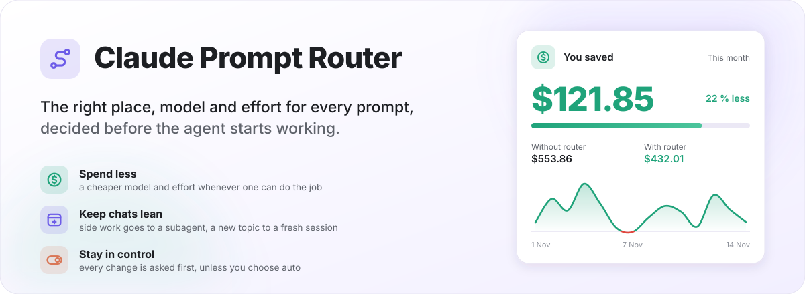
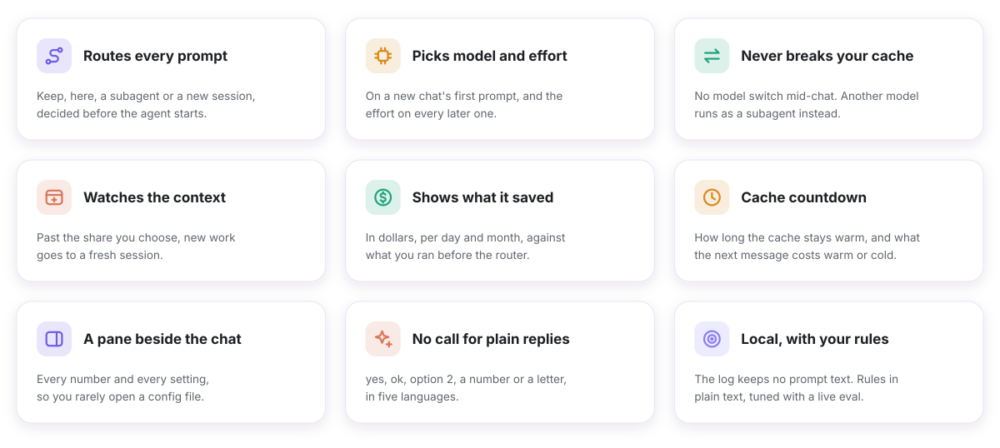
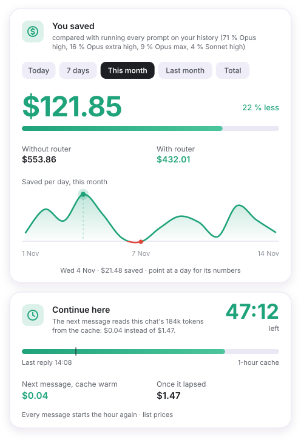
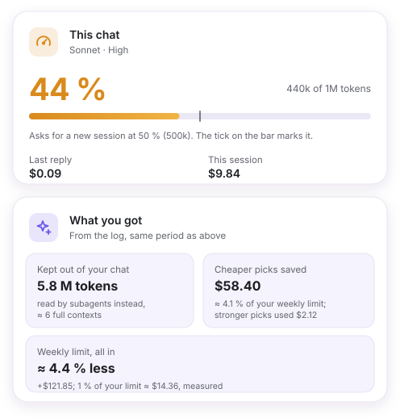
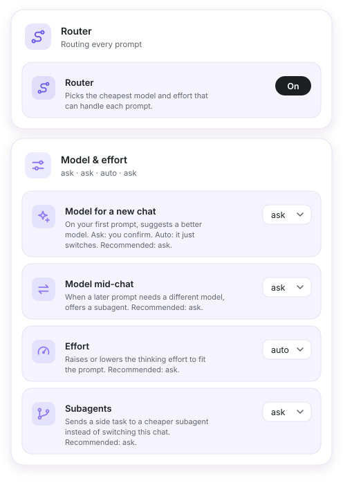
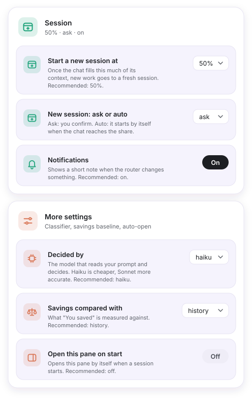
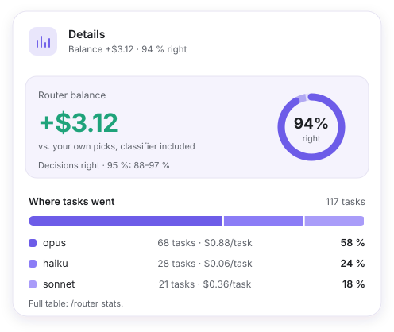
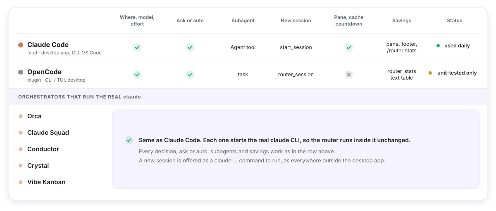

<div align="center">

<picture><source media="(prefers-color-scheme: dark)" srcset="docs/images/hero-dark.svg"></picture>

<h1>🧭 Claude Prompt Router</h1>

**The right place, model and effort for every prompt, decided before the agent starts.**


[Why](#why) •
[Features](#features) •
[Quick start](#quick-start) •
[How it works](#how-it-works) •
[The pane](#the-pane) •
[Settings](#settings) •
[Savings](#savings) •
[Platforms](#platforms) •
[Commands](#commands) •
[Development](#development) •
[FAQ](#faq)

</div>

---

<a id="why"></a>
## 💡 Why

Every reply in a long chat re-reads the whole context, so a side question there costs more than it should.
Opus on a rename wastes money, Haiku on a race condition wastes time.
The router makes one small classifier call per prompt and tells the agent where the prompt belongs and which model and effort it needs.

| 🔀 Where | 🧠 Model | 🎚️ Effort | 🙋 You decide |
| :---: | :---: | :---: | :---: |
| this chat, a subagent or a new session | Haiku, Sonnet, Opus, Fable for the rare hardest case | low, medium, high, xhigh, max | a question first, or `auto` |

<a id="features"></a>
## ✨ Features

<picture><source media="(prefers-color-scheme: dark)" srcset="docs/images/features-dark.svg"></picture>

<a id="quick-start"></a>
## 🚀 Quick start

| | 🟠 Claude Code | 🔵 OpenCode |
| --- | --- | --- |
| **1. Install** | `/plugin marketplace add Viktorooos/claude-prompt-router`<br>`/plugin install prompt-router@prompt-router` | `git clone https://github.com/Viktorooos/claude-prompt-router.git`<br>`node claude-prompt-router/adapters/opencode/install.ts` |
| **2. Start** | Open a new chat | Restart OpenCode |
| **3. See it** | `/router panel` | `/router stats` |
| **Options** | the pane, `/plugin` → prompt-router → Configure, or `~/.claude/settings.json` | `~/.config/opencode/prompt-router.json` |
| **Uninstall** | `claude plugin uninstall prompt-router@prompt-router` | `node claude-prompt-router/adapters/opencode/install.ts --uninstall` |

Options are read when a session starts. After a change, open a **new chat**.

Then type as usual. When a prompt does not belong in this chat, the agent asks before it starts:

```
╭─ Prompt Router ───────────────────────────────────────────╮
│ Where should this go? It is an unrelated feature, so a    │
│ fresh session fits.                                       │
│                                                           │
│   › New session (Sonnet · medium)      ← recommended      │
│     Subagent (Haiku · low)                                │
│     Do it here (Low)                                      │
│     Do it here (keep Medium)                              │
╰───────────────────────────────────────────────────────────╯
```

With `auto` it just acts and says so in one line:

```
Effort: Low (was Medium), small follow-up to the last fix
```

Tip: set `project` to what your chats are about, so the classifier fits your work.

<a id="how-it-works"></a>
## 🧩 How it works

<picture><source media="(prefers-color-scheme: dark)" srcset="docs/images/how-it-works-dark.svg"></picture>

| Decision | When |
| --- | --- |
| **keep** | An approval or an answer to the agent's question. Nothing changes. |
| **here** | Builds on what this chat read or changed, is trivial, or the chat is still small. Maybe a new effort. |
| **subagent** | A self-contained read, search, build or test run whose short result is needed here. |
| **session** | Unrelated to this chat, or long mechanical work. In a chat over 60k tokens, even a trivial unrelated task. |

- **No call for plain replies.** Up to five yes / no / ok / thanks / go on words (English, Czech, Spanish, German, French), `option 2`, a number or a letter pass with no classifier call. Slash commands pass too.
- **The cache stays intact.** The chat's model is set only on its first prompt. Later, a prompt that fits another model is offered as **Subagent (model · effort)** or **Stay here**, where only the effort is judged.
- **The classifier sees** your typed text, the chat's first and last few prompts, the start of the agent's last reply, the model, effort and context size.

<details>
<summary><b>Models and tiers</b></summary>

The router thinks in four tiers. Claude Code maps them to Claude models; in OpenCode the mapping is yours, from any provider.

| Tier | Claude Code | For | Price in / out per 1M | OpenCode default |
| --- | --- | --- | --- | --- |
| `light` | Haiku | Running, reading, searching, short answers | $0.10 / $0.50 | `anthropic/claude-haiku-5-5` |
| `standard` | Sonnet | Mechanical edits by an existing pattern | $2 / $10 | `anthropic/claude-sonnet-5-5` |
| `strong` | Opus | New logic, debugging, review, anything risky | $4 / $20 | `anthropic/claude-opus-5-5` |
| `top` | Fable | Only where Opus at high effort is likely not enough | $10 / $50 | `anthropic/claude-fable-5-1` |

<a id="fable"></a>
Fable is rare on purpose: a new architecture across several layers, a hard concurrency or security problem, a bug two fixes failed to solve, or a deep analysis where a wrong conclusion is costly. Never an everyday feature, a review, payments or a known migration. It is offered only when your platform has it.

</details>

<details>
<summary><b>Effort levels</b></summary>

| Level | For |
| --- | --- |
| **low** | Simple work |
| **medium** | The default |
| **high** | Where a hidden mistake costs money, data or trust |
| **xhigh** | Long critical work you hand off |
| **max** | Only when you ask for it, or a one-off irreversible step with a very high cost of a mistake |

Words like *important* or *carefully* never raise it beyond **high** on their own.

</details>

<a id="the-pane"></a>
## 🪟 The pane

`/router panel` opens it beside the chat (or set `openPane: on`). In a terminal you get a text version. It updates after every reply. Claude Code only. The pictures use sample data from [`docs/images/generate.mjs`](docs/images/generate.mjs).

<table>
<tr>
<td width="50%" valign="top"><picture><source media="(prefers-color-scheme: dark)" srcset="docs/images/pane-saved-cache-dark.svg"></picture></td>
<td width="50%" valign="top"><picture><source media="(prefers-color-scheme: dark)" srcset="docs/images/pane-this-chat-dark.svg"></picture></td>
</tr>
<tr>
<td valign="top"><b>You saved</b> for Today, 7 days, This month, Last month or Total, with a per-day line (red on a day in the minus). <b>Continue here</b> counts down the chat's cache and shows the next message's price warm or lapsed.</td>
<td valign="top"><b>This chat</b>: model, effort, context fill with a tick where a new session is asked for, last reply and session cost. <b>What you got</b>: tokens kept out by subagents, cheaper picks, the weekly limit measured from the app's rate limit.</td>
</tr>
<tr>
<td valign="top"><picture><source media="(prefers-color-scheme: dark)" srcset="docs/images/pane-settings-a-dark.svg"></picture></td>
<td valign="top"><picture><source media="(prefers-color-scheme: dark)" srcset="docs/images/pane-settings-b-dark.svg"></picture></td>
</tr>
<tr>
<td colspan="2"><b>Settings</b>: every option, grouped (Router, Model &amp; effort, Session, More settings), each with one line and the recommended value. Saved into the mod's options; applies to a new chat.</td>
</tr>
<tr>
<td valign="top"><picture><source media="(prefers-color-scheme: dark)" srcset="docs/images/pane-details-dark.svg"></picture></td>
<td valign="top"><b>Details</b>: the per-task <a href="#balance">balance</a> (negative in red), <b>Decisions right</b> with its 95 % Wilson range, and <b>Where tasks went</b> per model with the cost per task.</td>
</tr>
</table>

<a id="settings"></a>
## ⚙️ Settings

Same keys on every platform, except where marked. The first value is the default. **Rec.** is what the pane recommends.

| Option | Values (default first) | Rec. | What it does |
| --- | --- | --- | --- |
| `project` | text, empty | set it | What your chats are about. Empty: a software project. |
| `rules` | text, empty | | Your own routing rules. They win over the built-in ones. |
| `language` | `auto`, or a language name | | Language of the reason and the questions. `auto`: each prompt's language. |
| `classifier` | `sonnet`, `haiku`, `opus` (OpenCode: `standard`, `light`, `strong`) | `haiku` | The model that makes the call on every prompt. |
| `effortDetection` | `ask`, `auto`, `off` | `ask` | The effort for a prompt that stays here. |
| `firstChatDetection` | `ask`, `auto`, `off` | `ask` | The model on a new chat's first prompt. |
| `midChatModelDetection` | `ask`, `auto`, `off` | `ask` | A later prompt that fits another model. `ask`: Subagent or Stay here. `auto`: the agent picks and says which. |
| `subagentSuggestions` | `ask`, `auto`, `off` | `ask` | A self-contained task. `auto`: the subagent starts right away. `off`: stays here. |
| `sessionSuggestions` | `ask`, `auto`, `off` | `ask` | An unrelated task or a full chat. `auto`: a chat past `newSessionAt` starts the session itself (desktop app, OpenCode). |
| `newSessionAt` | `50%`, `10%` … `100%` in steps of 10 | `50%` | Past this share of the context window, any prompt that would stay here is offered as a new session. |
| `notifications` | `on`, `off` | `on` | A toast after an automatic change, and a footer label in Claude Code. |
| `stats` | `on`, `off` | | Claude Code. Logs decisions and token use for the [savings](#savings). |
| `openPane` | `off`, `on` | `off` | Claude Code. Opens the pane when a session starts. |
| `compareWith` | `first`, `<model>-<effort>`, `history` | `first` | What the savings are measured against. `history` is Claude Code only. |
| `savingsIn` | `limit`, `money` | `limit` | Claude Code. The saving as a share of your weekly limit, or dollars. |

`/router` shows every option, its value and where it came from.

<details>
<summary><b>Where options live, and examples</b></summary>

**Claude Code**, `~/.claude/settings.json`:

```json
"pluginConfigs": {
  "prompt-router@prompt-router": {
    "options": {
      "project": "a React web app and a Node.js backend",
      "rules": "Database migrations: opus, high.",
      "effortDetection": "auto",
      "firstChatDetection": "auto"
    }
  }
}
```

The `/plugin` Configure dialog lists a shorter set of values (`sessionSuggestions` `ask`/`off`, `newSessionAt` `off`, `40%` … `70%`). The pane and `settings.json` take every value above.

**OpenCode**, `~/.config/opencode/prompt-router.json` (written by the installer):

```json
{
  "classifier": "standard",
  "effortDetection": "ask",
  "newSessionAt": "50%",
  "models": { "light": "anthropic/claude-haiku-5-5", "standard": "anthropic/claude-sonnet-5-5", "strong": "anthropic/claude-opus-5-5", "top": "anthropic/claude-fable-5-1" },
  "variants": { "low": "low", "medium": "medium", "high": "high", "xhigh": "xhigh", "max": "max" }
}
```

| OpenCode key | What it does |
| --- | --- |
| `models` | `provider/model` per tier, any provider, mixed if you like |
| `variants` | The model variant per effort level; `""` uses the model's default |
| `timeoutMs` | The classifier's time limit, plugin options in `opencode.json` only (default 20000) |

Instead of the JSON file you can list the shim in `opencode.json` with its options. Move it out of `plugins/` first, or it loads twice.

</details>

<details>
<summary><b>Your own rules</b></summary>

`rules` is plain text appended to the classifier's prompt. Write it like a note to a colleague:

```
Database migrations: opus, high.
Payments, vouchers, auth: opus, high.
Copy changes on the marketing site: haiku, low.
```

Name the tier either way: `haiku`/`sonnet`/`opus`/`fable` or `light`/`standard`/`strong`/`top`.

</details>

<details>
<summary><b>No questions at all, and old option names</b></summary>

- No questions about effort or model: `effortDetection` and `firstChatDetection` `auto`, `midChatModelDetection` `off`. To stop "Where should this go?" too: `subagentSuggestions` and `sessionSuggestions` `off`.
- `effortMode` is now `effortDetection`. `modelMode` is now `firstChatDetection`, and `modelMode: off` also turns off `midChatModelDetection`. An old key counts only when the new one is missing.

</details>

<a id="savings"></a>
## 💰 Savings

An **estimate** from list prices. The pane, `/router stats` and the stats page use it.

| Number | How it is counted |
| --- | --- |
| **Without router** | Each turn's tokens priced on the compared model (`compareWith`) |
| **With router** | What the tokens really cost, the classifier included |
| **Saved** | The difference. In the pictures: $553.86 − $432.01 = **$121.85**, 22 % less |
| **Extra cost** | A stronger model the router picked, shown apart, never hidden |
| **Balance per task** | A task's turns on the model they would have run on, minus what they cost, minus re-work |

- Prices live only in [`core/prices.ts`](plugins/prompt-router/core/prices.ts). Effort is not repriced: only the token count depends on it.
- `compareWith: first` counts only the router's own switches. `history` compares with the mix you ran before the router, read once from your transcripts in the background.
- The log keeps the tokens, so a new `compareWith` reprices old data too.
- The weekly limit is measured from the app's own rate limit, not guessed.

The data stays on your machine: `~/.claude/mods-logs/prompt-router-stats.jsonl`, trimmed to 90 days and 5 MB. **No prompt text, replies or file names**, only a short hash to spot a repeated prompt. Turn it off with `"stats": "off"`.

<a id="balance"></a>
<details>
<summary><b>How the balance per task is worked out</b></summary>

- **Task** = a routed prompt plus the prompts that continue or fix it, ending at a new topic or after 30 min of quiet. Its subagents count in.
- **Re-work**: when the task failed (you switched to a stronger model, repeated the prompt, said it was wrong, broke it off), its follow-up turns count as lost, weighted 1 / 1 / 0.7 / 0.4. A fix only the classifier noticed weighs 0.2.
- **`~`** marks a rough number: fewer than 12 routed tasks.
- **Decisions right** = the share of routed tasks without a failure, with a 95 % Wilson range.

</details>

<a id="platforms"></a>
## 🖥️ Platforms

<picture><source media="(prefers-color-scheme: dark)" srcset="docs/images/platforms-dark.svg"></picture>

| | 🟠 Claude Code | 🔵 OpenCode |
| --- | --- | --- |
| **Runs as** | a mod: desktop app, CLI, VS Code, Remote Control | a plugin: CLI / TUI, desktop |
| **Ask** | dialog | question tool |
| **Switch effort / model** | `switch` tool | `router_switch` tool, held on each message until you move the picker |
| **Subagent** | Agent tool with model and effort | `task` with `router-light` … `router-top` |
| **New session** | `start_session` in the desktop app, a `claude …` command elsewhere | `router_session` tool |
| **Pane, cache countdown, weekly limit** | ✅ | ❌ |
| **Savings** | pane, footer, `/router stats` | `/router stats`, `router_stats` tool |
| **Status** | used daily | unit-tested only, not yet run live |

<a id="opencode"></a>
### 🔵 OpenCode, aligned with Claude Code

Both platforms now share one flow, [`core/flow.ts`](plugins/prompt-router/core/flow.ts). What changed in OpenCode:

| What | Now |
| --- | --- |
| **Questions** | The Claude Code wording, "ACTION FIRST… call the question tool". The line "if the question tool is not available, ask in one short message" is gone. |
| **Declined offers** | Logged at the end of the turn |
| **`subagentSuggestions: auto`** | The subagent starts right away |
| **`sessionSuggestions: auto`** | The new session starts by itself |
| **An offer** | Holds until the next prompt |
| **Taking a subagent offer** | Counts only for a subagent on the offered tier |
| **Classifier** | Told it reads "an OpenCode chat" |

OpenCode needs the V1 plugin API (`@opencode-ai/plugin` 1.19.x). The installer writes a shim to `~/.config/opencode/plugins/prompt-router.ts` that loads the plugin from your clone, so keep the clone where it is.

<a id="orchestrators"></a>
### 🧵 Orchestrators

| Tool | Router | Pane | New session |
| --- | --- | --- | --- |
| Orca, Claude Squad, Conductor, Crystal, Vibe Kanban | ✅ runs inside the real `claude` they start | ❌ | a `claude …` command instead of `start_session` |

Every decision, `ask` or `auto`, subagents and savings work as in Claude Code.

<a id="commands"></a>
## ⌨️ Commands

| Command | 🟠 Claude Code | 🔵 OpenCode |
| --- | :---: | :---: |
| `/router` — status, this chat's model and effort, every option | ✅ | ✅ |
| `/router panel` (or `pane`) — open the pane | ✅ | |
| `/router stats` — savings as a text table | ✅ (and a page with a 30-day graph) | ✅ |
| `/router off` / `/router on` — turn it off or on, remembered | ✅ | ✅ |

Tools the agent calls: `switch` and `test` (Claude Code); `router_switch`, `router_session` and `router_stats` (OpenCode).

<a id="development"></a>
## 🧪 Development

| Run | Command |
| --- | --- |
| Claude Code unit tests | `cd plugins/prompt-router && claude plugin test . && node --test test/node/` |
| Plugin manifest | `cd plugins/prompt-router && claude plugin validate .` |
| OpenCode and shared tests | `node --test adapters/*/test/` |
| README pictures | `node docs/images/generate.mjs` |
| Live eval | ask Claude to run `mcp__prompt-router__test` with `file` = `plugins/prompt-router/test/cases.json`, `runs` = `3`, `out` = a TSV, then `python3 -I plugins/prompt-router/test/eval.py <out.tsv>` |

Unit tests use canned classifier replies, no model calls.

| File | What lives there |
| --- | --- |
| [`core/router.ts`](plugins/prompt-router/core/router.ts) | Classifier prompt, parsing, routing rules, options |
| [`core/flow.ts`](plugins/prompt-router/core/flow.ts) | What happens after a decision, shared by both platforms |
| [`core/prices.ts`](plugins/prompt-router/core/prices.ts) | Model prices, the only place with them |
| [`core/stats.ts`](plugins/prompt-router/core/stats.ts) | Savings, balance, text table, page |
| [`core/panel.ts`](plugins/prompt-router/core/panel.ts) | The pane's numbers |
| [`hooks/register.tsx`](plugins/prompt-router/hooks/register.tsx) | Claude Code wiring: dialogs, `switch`, `/router`, the pane |
| [`adapters/opencode/`](adapters/opencode) | The OpenCode plugin and installer |
| [`.claude-plugin/plugin.json`](plugins/prompt-router/.claude-plugin/plugin.json) | Version and option definitions |

<a id="faq"></a>
## ❓ FAQ

<details>
<summary><b>It asks me even though I set <code>auto</code>.</b></summary>

Open a new chat: options are read when a session starts. Run `/router` to see each value and its source. In Claude Code, use the full id `prompt-router@prompt-router` in `pluginConfigs`, and check that no second copy of the mod runs.

</details>

<details>
<summary><b>Why a subagent for a prompt that belongs here?</b></summary>

The prompt fits another model. Switching this chat's model would make it re-read the whole context at full price, so a subagent on that model does it and returns a short result. **Stay here** keeps the model.

</details>

<details>
<summary><b>"You saved" is red with a minus.</b></summary>

In that period the router cost more than it saved, for example stronger picks for hard tasks or a cheap pick that had to be redone. **Details** shows the parts.

</details>

<details>
<summary><b>It never offers Fable.</b></summary>

Only when your platform has it, and only for the rare cases in [Models and tiers](#fable).

</details>

<details>
<summary><b>What does it send anywhere?</b></summary>

Only the classifier call to your own model provider. The stats stay in a local file with no prompt text.

</details>

## 📄 License

[MIT](LICENSE) © 2026 Viktor Kadeřábek
