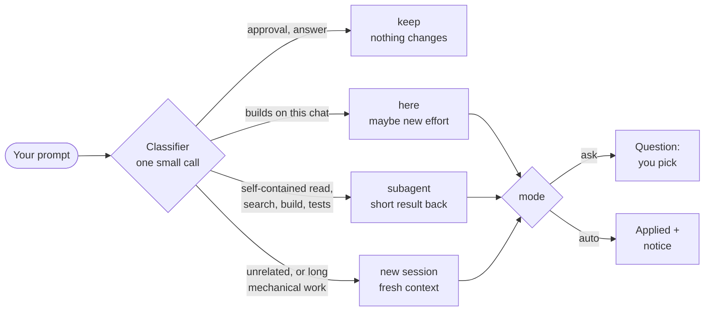

<div align="center">

# 🧭 Prompt Router

### The right place, the right model, the right effort, for every prompt.

A prompt router for **Claude Code**, **Codex** and **OpenCode** that looks at each prompt before the agent starts working<br>
and decides whether it belongs in **this chat**, a **subagent** or a **fresh session**, and which **model** and **effort** it needs.


[Platforms](#-platforms) •
[What it does](#-what-it-does) •
[How it decides](#-how-it-decides) •
[Claude Code](#-claude-code) •
[Codex](#-codex) •
[OpenCode](#-opencode) •
[FAQ](#-faq) •
[Changelog](#-changelog)

</div>

---

## 💡 Why

> Every reply in a long chat re-reads the whole context. Opus on a rename burns money. Haiku on a race condition burns time.

Prompt Router makes **one small classifier call per prompt** and tells the agent, before any work starts, where the prompt belongs and what it needs. You stay in control: every change is offered first, unless you tell it to just do it.

<table>
<tr>
<td width="25%" align="center">🔀<br><b>Where</b><br><sub>this chat, a subagent or a new session</sub></td>
<td width="25%" align="center">🧠<br><b>Model</b><br><sub>a small, a mid, a big model, or the top one for the rare hardest cases</sub></td>
<td width="25%" align="center">🎚️<br><b>Effort</b><br><sub>low, medium, high, xhigh, max</sub></td>
<td width="25%" align="center">🙋<br><b>You decide</b><br><sub>a question by default, or <code>auto</code></sub></td>
</tr>
</table>

## 🧭 Platforms

One router, three platforms. The decisions are the same everywhere; what each platform lets a plugin do differs.

| | 🟠 [Claude Code](#-claude-code) | ⚫ [Codex](#-codex) | 🔵 [OpenCode](#-opencode) |
| --- | --- | --- | --- |
| **Runs as** | a mod (plugin) | a `UserPromptSubmit` hook | a plugin |
| **Covers** | desktop app, CLI, VS Code, Remote Control | Codex CLI and the ChatGPT desktop app (shared `~/.codex`) | CLI / TUI and desktop |
| **Classifies each prompt** | ✅ | ✅ | ✅ |
| **Switches effort by itself** (`auto`) | ✅ | ❌ shows a `/model <model> <effort>` line to run | ✅ held per message; can change mid-turn |
| **Switches the model by itself** (`auto`) | ✅ | ❌ same `/model` line | ✅ from the next message |
| **Asks before switching** (`ask`) | dialog | the agent asks in a text message | question tool (text if missing) |
| **Sends to a subagent** | Agent tool with model and effort | `spawn_agent` with model and `reasoning_effort` | `task` with a `router-<model>` subagent |
| **New session** | `start_session` in the app; a `claude --model … --effort …` command elsewhere | a `codex -m … -c model_reasoning_effort=…` command | `router_session` tool (fallback: an `opencode` command) |
| **Checks the model on the first prompt** | ✅ | ✅ (as a suggestion) | ✅ |
| **`/router` command** | ✅ | typed as a prompt; the TUI may take it as an unknown command | ✅ config command, answered by the agent + toast |
| **Options live in** | `~/.claude/settings.json` (`pluginConfigs`) or `/plugin` | `~/.codex/prompt-router.json` | `~/.config/opencode/prompt-router.json` or `opencode.json` |
| **Default classifier** | Sonnet | `gpt-6-luna` | `anthropic/claude-sonnet-5-5` |
| **Status** | used daily | unit-tested; hook run with the real classifier, Codex runs it once you trust it in `/hooks` | ⚠️ unit-tested only |

> [!NOTE]
> **Architecture.** [`plugins/prompt-router/core/router.ts`](plugins/prompt-router/core/router.ts) holds the shared logic: the classifier prompt, parsing its reply, the routing rules. [`hooks/register.tsx`](plugins/prompt-router/hooks/register.tsx) (the Claude Code mod), [`adapters/codex/`](adapters/codex) and [`adapters/opencode/`](adapters/opencode) only wire it to each platform.

## 👀 What it does

### 1. Sends unrelated or heavy work elsewhere

When a prompt does not belong in this chat, the agent asks before it starts (here in Claude Code):

```
╭─ Prompt Router ─────────────────────────────────────────────────────╮
│ Where should this go? It is an unrelated feature, so a fresh        │
│ session fits.                                                       │
│                                                                     │
│   › New session (Sonnet · medium)      ← recommended                │
│     Subagent (Haiku · low)                                          │
│     Do it here (Low)                                                │
│     Do it here (keep Medium)                                        │
╰─────────────────────────────────────────────────────────────────────╯
```

### 2. Tunes the effort of this chat

When the prompt stays here but needs more or less thinking, you get **Switch / Keep as is**, or, with `effortMode: auto`, it just switches and tells you:

```
Effort: Low (was Medium), small follow-up to the last fix
```

### 3. Checks the model on a new chat's first prompt

Opus picked for a rename? Haiku for debugging? On the first prompt the router checks whether the selected model fits and offers (or, with `modelMode: auto`, makes) the switch.

### 4. Stays out of the way

Approvals (`yes`, `go on`, `option 2`), answers to the agent's questions, slash commands and prompts where nothing needs to change pass through untouched.

## 🧩 How it decides



The classifier sees the new prompt (only the text you typed), the chat's first and last few prompts, the start of the agent's last reply, and the current model, effort and context size.

<details open>
<summary><b>🔀 Where</b></summary>

| | When |
| --- | --- |
| **keep** | An approval or an answer to the agent's question. Nothing changes. |
| **here** | Builds on what this chat already read or changed, is trivial, or the chat is still small. |
| **subagent** | A self-contained search, read, build or test run whose short result is needed here. |
| **session** | Unrelated to this chat, or long mechanical work better done with a fresh context. In a chat over **60k tokens**, even a trivial unrelated task goes here. |

</details>

<details open>
<summary><b>🧠 Model</b></summary>

The router thinks in four classes. Each platform maps them to its own models (Codex and OpenCode let you change the mapping).

| Class | For | Claude price (in / out per 1M) | Codex default | OpenCode default |
| --- | --- | --- | --- | --- |
| **Haiku** | Running, reading, searching, short answers | $0.10 / $0.50 | `gpt-6-luna` | `anthropic/claude-haiku-5-5` |
| **Sonnet** | Mechanical edits by an existing pattern | $2 / $10 | `gpt-6.1-terra` | `anthropic/claude-sonnet-5-5` |
| **Opus** | New logic, debugging, review, anything risky | $4 / $20 | `gpt-6.1-sol` | `anthropic/claude-opus-5-5` |
| **Fable** | Only where Opus at high effort is likely not enough | $10 / $50 | `gpt-6-astra` | `anthropic/claude-fable-5-1` |

**Fable** is rare on purpose. ✅ A new architecture across several layers with no clear solution, a hard concurrency or security problem whose reach is unknown, a bug two fixes already failed to solve, a deep analysis where a wrong conclusion costs a lot. ❌ Never for an everyday feature (however big), a code review, payments or a migration with a known approach. It is offered only when your platform has it (Claude Code: your model picker lists it; Codex: it is in `~/.codex/models_cache.json`; OpenCode: a provider lists it).

</details>

<details open>
<summary><b>🎚️ Effort</b></summary>

| | For |
| --- | --- |
| **low** | Simple work |
| **medium** | The default |
| **high** | Where a hidden mistake costs money, data or trust |
| **xhigh** | Long critical work you hand off (overnight, over the weekend) |
| **max** | Only when you ask for the maximum, or a one-off irreversible step with a very high cost of a mistake (production data, a live security incident) |

Words like *important*, *carefully* or *do it properly* never raise it beyond **high** on their own.

</details>

## ⚙️ Options

The same options on every platform; where they live is in each platform's section.

| Option | What it does | Default |
| --- | --- | --- |
| `project` | What your chats are about, in a few words | empty (a software project) |
| `rules` | Your own routing rules; they win over the built-in ones | empty |
| `language` | Language of the reason and of the questions the agent asks | `auto` (each prompt's language) |
| `classifier` | Model class that makes the call: `sonnet`, `haiku` (cheaper, less accurate) or `opus` (most accurate, most expensive) | `sonnet` (Codex: `haiku`) |
| `effortMode` | `ask`: a question before the effort changes · `auto`: just do it | `ask` |
| `modelMode` | New chat's first prompt: `ask` · `auto` · `off` (never touch the model) | `ask` |

### Your own rules

`rules` is plain text appended to the classifier's prompt, and it wins over the built-in rules. Write it like a note to a colleague:

```
Database migrations: opus, high.
Translating finished Compose screens to SwiftUI: sonnet, medium.
Payments, vouchers, auth: opus, high.
Copy changes on the marketing site: haiku, low.
```

Use the class names (`haiku`, `sonnet`, `opus`, `fable`) on every platform; Codex and OpenCode map them to their models.

> [!TIP]
> Want no questions about effort or model at all? Set both `effortMode` and `modelMode` to `auto`. "Where should this go?" is still asked, since moving work to another session is always your call.

---

## 🟠 Claude Code

### Install

```
/plugin marketplace add Viktorooos/prompt-router
/plugin install prompt-router@prompt-router
```

That's it. Open a new chat and type as usual. Optionally tell the router what your project is so its calls fit your work.

### Configuration

**Where to set the [options](#%EF%B8%8F-options):** `/plugin` → prompt-router → Configure, or `~/.claude/settings.json`:

```json
"pluginConfigs": {
  "prompt-router@prompt-router": {
    "options": {
      "project": "a React web app and a React Native mobile app for sharing recipes, Node.js backend",
      "rules": "Database migrations: opus, high. Copy changes on the marketing site: haiku, low.",
      "language": "English",
      "effortMode": "auto",
      "modelMode": "auto"
    }
  }
}
```

> [!IMPORTANT]
> Options are read when a session starts. After a change, open a **new chat** to see it.

### Commands

| Command | What it does |
| --- | --- |
| `/router` | Status, this chat's model and effort, and whether the router holds the effort |
| `/router off` | Turn it off (remembered across sessions) |
| `/router on` | Turn it back on |

> [!NOTE]
> **Clients.** The desktop app, the terminal CLI, VS Code and Remote Control all run it. Where the chat cannot start a session itself (terminal, VS Code), "New session" gives you a `claude --model … --effort …` command to run in a new terminal. `claude -p` and Agent SDK runs pass untouched: their flags already chose the model and effort.

### Changing the mod itself

| File | What lives there |
| --- | --- |
| [`core/router.ts`](plugins/prompt-router/core/router.ts) | Shared with Codex and OpenCode: the classifier prompt (`TEMPLATE`, `FABLE_RULE`), parsing, the routing rules |
| [`hooks/register.tsx`](plugins/prompt-router/hooks/register.tsx) | The Claude Code wiring: the dialogs, the `switch` tool, `/router` |
| [`test/router.test.ts`](plugins/prompt-router/test/router.test.ts) | Unit tests with canned classifier replies |
| [`test/cases.json`](plugins/prompt-router/test/cases.json) + [`expected.json`](plugins/prompt-router/test/expected.json) | Live eval cases and the right answers |
| [`.claude-plugin/plugin.json`](plugins/prompt-router/.claude-plugin/plugin.json) | Version and option definitions |

> [!TIP]
> Keep the classifier prompt in flat one-line bullets. Nested bullets inside a rule shifted Sonnet's calls on unrelated cases in the eval.

<details>
<summary><b>How switching works under the hood</b></summary>

- After **Switch** or **Do it here (…)**, Claude changes this chat's model or effort through the mod's own `switch` tool, because Claude Code's session tools refuse the chat they run in.
- `switch` refuses a model this chat is not offered (e.g. Fable when your picker does not list it) and says what it skipped. If it fails, Claude tells you the `/model` or `/effort` command to run.
- Where the effort setting cannot be changed, the router puts the level on each request until you move the effort picker yourself.
- A prompt typed while a turn is running keeps the model and effort.

</details>

### Disable

`/router off` for a while · `/plugin` → prompt-router → Disable · or `claude plugin uninstall prompt-router@prompt-router`.

---

## ⚫ Codex

The Codex CLI and the ChatGPT desktop app share `~/.codex`, so one install covers both.

### Requirements

- Node **26+** (the hook runs TypeScript directly)
- The Codex CLI, logged in (the classifier runs on your ChatGPT login, no API key)
- A clone of this repo; the hook runs from it, so keep it where it is

### Install

```bash
git clone https://github.com/Viktorooos/prompt-router.git
node prompt-router/adapters/codex/install.ts
```

It merges a `UserPromptSubmit` hook (`node <repo>/adapters/codex/hook.ts`) into `~/.codex/hooks.json`, keeping your other hooks and a backup as `hooks.json.bak-prompt-router-<time>`, and writes `~/.codex/prompt-router.json` with the defaults when there is none. `$CODEX_HOME` is respected.

Then **trust the hook once**: run `codex`, type `/hooks`, trust **"Routing..."**, and start a new session.

**ChatGPT desktop app.** The desktop app does not run `UserPromptSubmit` hooks (tested with 0.166). So the installer also adds, between marker comments and after a backup:
- a `prompt_router` MCP server (`node <repo>/adapters/codex/mcp.ts`, tool `route`, approved without a prompt) to `~/.codex/config.toml`
- a short rule to `~/.codex/AGENTS.md`: call `route` with the prompt first, and skip the call when the hook's note is already there (the CLI)

`route` runs the same code as the hook and returns the same note. Restart the desktop app afterwards. The cost is one tool call per prompt (3–4 s), and the model may now and then skip the rule.

> [!IMPORTANT]
> Codex runs a new or changed hook only after you trust it. Trust it again after every update that changes the hook command (for example after moving the repo and installing again).

### Options

`~/.codex/prompt-router.json`, the same keys as Claude Code plus the Codex ones:

```json
{
  "classifier": "haiku",
  "effortMode": "ask",
  "modelMode": "ask",
  "project": "",
  "rules": "",
  "language": "auto",
  "enabled": true,
  "timeoutMs": 20000,
  "models": { "haiku": "gpt-6-luna", "sonnet": "gpt-6.1-terra", "opus": "gpt-6.1-sol", "fable": "gpt-6-astra" },
  "efforts": { "low": "low", "medium": "medium", "high": "high", "xhigh": "xhigh", "max": "max" }
}
```

| Key | What it does |
| --- | --- |
| `models` | The Codex model for each router class |
| `efforts` | The Codex reasoning effort for each router level; a model that does not take a level (per `models_cache.json`) gets the nearest lower one |
| `enabled` | `/router off` and `/router on` write it |
| `timeoutMs` | The classifier's time limit |

The classifier is a read-only `codex exec` on the `classifier` class (`gpt-6-luna`) at low effort: about **3–4 s per prompt**, on your ChatGPT login. Its log is `~/.codex/log/prompt-router.log`.

### What differs from Claude Code

> [!WARNING]
> Codex cannot switch a running session's model or effort from a hook (tested: a running session does not re-read `config.toml` either). So:
> - **auto** mode shows one line, `Prompt Router: for this, switch with /model <model> <effort>` (also as a system message), and the agent carries on at the current setting.
> - **ask** mode: the agent asks in a text message, with the options as a numbered list. On **Switch** you get the same `/model` line; it applies from your next prompt.

- **New session** gives you a command to run in a new terminal: `codex -m <model> -c model_reasoning_effort=<effort> "<task>"`.
- **Subagent** is `spawn_agent` with `model` and `reasoning_effort`; without that tool the agent says so and does it here.
- **Fable** (`gpt-6-astra`) is offered only when it is in your `~/.codex/models_cache.json` or the chat already runs on it.
- **`/router`** typed as a prompt may be taken by the TUI as an unknown command (not verified); `/router off` / `on` can also be done by editing `enabled`.

### Uninstall

```bash
node prompt-router/adapters/codex/install.ts --uninstall
```

It removes only the router's entry from `~/.codex/hooks.json`, the MCP server block from `config.toml` and the rule from `AGENTS.md` (each after a backup), and keeps your options file.

---

## 🔵 OpenCode

For the OpenCode CLI / TUI and desktop.

> [!WARNING]
> The OpenCode adapter is **unit-tested only** (27 tests with a mock client) and has not been run against a real OpenCode yet. It is written against the V1 plugin API (`@opencode-ai/plugin` 1.19.x) and needs `@opencode-ai/plugin` available in `~/.config/opencode` (OpenCode installs it there).

### Install

```bash
git clone https://github.com/Viktorooos/prompt-router.git
node prompt-router/adapters/opencode/install.ts
```

It writes a shim, `~/.config/opencode/plugins/prompt-router.ts`, that re-exports the plugin from the repo (so keep the repo where it is), and `~/.config/opencode/prompt-router.json` with the defaults when there is none. A file it would overwrite is kept as `prompt-router.ts.bak-<time>`. Restart OpenCode to load it.

### Options

**Either** `~/.config/opencode/prompt-router.json` (the shim in `plugins/` is auto-loaded, and OpenCode passes no options to auto-loaded plugins):

```json
{
  "classifier": "sonnet",
  "effortMode": "ask",
  "modelMode": "ask",
  "project": "",
  "rules": "",
  "language": "auto",
  "models": { "haiku": "anthropic/claude-haiku-5-5", "sonnet": "anthropic/claude-sonnet-5-5", "opus": "anthropic/claude-opus-5-5", "fable": "anthropic/claude-fable-5-1" },
  "variants": { "low": "low", "medium": "medium", "high": "high", "xhigh": "xhigh", "max": "max" }
}
```

**Or** in `opencode.json`: move the shim out of `plugins/` (else it loads twice) and list it with its options, which then win and the JSON file is not read:

```json
"plugin": [["file:///Users/<you>/.config/opencode/prompt-router.ts", { "effortMode": "auto", "timeoutMs": 20000 }]]
```

| Key | What it does |
| --- | --- |
| `models` | The `provider/model` for each router class |
| `variants` | The model variant (`provider.<p>.models.<m>.variants.<name>`) for each router level; `""` uses the model's default |
| `timeoutMs` | The classifier's time limit (plugin options only; default 20000) |

`/router off` / `on` is kept in `~/.config/opencode/prompt-router/state.json`, next to the log `prompt-router.log` (also sent to OpenCode's own log). The classifier runs in a throwaway session with no tools, deleted afterwards.

### What differs from Claude Code

- **A switch is a per-message hold.** A plugin cannot move the picker, so the router puts the variant (and model) on each message until you move the picker yourself; the picker in the UI does not move.
- **Effort** can change mid-turn (through `chat.params`); the **model** only from the next message.
- **Subagents** `router-haiku`, `router-sonnet`, `router-opus` and `router-fable` are added through the config hook; the agent calls `task` with one of them, and the router sets its effort.
- **New sessions** start through the `router_session` tool (open them with `/sessions`); if it fails, you get an `opencode --model … --prompt …` command.
- **`/router`** is a config command: the agent answers with the status, plus a toast.
- **Fable** is offered only when a provider lists `models.fable` or the chat runs on it.

### Uninstall

```bash
node prompt-router/adapters/opencode/install.ts --uninstall
```

It removes the shim (only if it is the router's), puts back the newest file it replaced, and keeps your options file.

---

## 🧪 Tests

**Unit tests** (canned classifier replies, no model calls), from the repo root:

```bash
claude plugin test plugins/prompt-router   # Claude Code mod: 47
node --test adapters/codex/test/           # Codex: 27
node --test adapters/opencode/test/        # OpenCode: 27 (mock client)
```

**Live eval** of the classifier (shared by all platforms): in a Claude Code session with the mod loaded, ask Claude to run the `mcp__prompt-router__test` tool with `file` = the absolute path of `plugins/prompt-router/test/cases.json`, `runs` = `3` and `out` = a TSV path, then:

```bash
python3 -I plugins/prompt-router/test/eval.py <out.tsv>
```

Cases can override `project`, `rules`, `language`, `classifier` and `models` (e.g. without `fable`), and `template` takes a classifier prompt file, so you can tune the rules without reloading the mod. `eval.py` also lists cases that waver between runs.

| Classifier | Last eval (123 cases, incl. Fable / xhigh / max boundaries) |
| --- | --- |
| Sonnet, 3 runs | ✅ 369 / 369 |
| Opus | ✅ 123 / 123 |
| Haiku | ⚠️ 114 / 123 (none of the misses raised a tier) |

## 💰 Cost

One small classifier call per prompt: low effort, at most 150 output tokens, on the model you pick in `classifier`. With the default Sonnet in Claude Code, that is a fraction of a cent per prompt. In Codex it runs on your ChatGPT plan and adds about 3–4 s before each prompt. The savings come from not running a 200k-token chat on a question that needed a fresh one.

## ❓ FAQ

<details>
<summary><b>It asks me even though I set <code>auto</code>.</b></summary>

Options are read when a session starts, so open a new chat. In Claude Code, put them under the full id `prompt-router@prompt-router` in `pluginConfigs`: an entry under plain `prompt-router` is used only when there is no full-id entry, and `/router` tells you to rename it. Also check that no second copy of the mod runs (`claude plugin list`, and any dev copy under `~/.claude/dev-mods/`), since a copy without your options falls back to `ask`. In Codex, `auto` still cannot switch the chat; you get the `/model` line instead of a question.

</details>

<details>
<summary><b>Why didn't it suggest a new session when I changed topic?</b></summary>

Questions and opinions about what this chat is already doing stay here: the answer is short and builds on the context. Once the topic turns into a new piece of work, the router offers a session.

</details>

<details>
<summary><b>It never offers Fable.</b></summary>

Fable is offered only when your platform has it (see [Model](#-how-it-decides)), and only for the rare cases above. Everyday features, reviews and known migrations go to Opus.

</details>

<details>
<summary><b>Codex runs nothing after the install.</b></summary>

Trust the hook: `codex` → `/hooks` → trust "Routing...", then start a new session. Errors go to `~/.codex/log/prompt-router.log`.

</details>

<details>
<summary><b>Can I use it with the Effort Optimizer mod?</b></summary>

Use one of them, not both: they both set effort per prompt.

</details>

## 📜 Changelog

| Version | Changes |
| --- | --- |
| **0.6.0** | Codex and OpenCode adapters (`adapters/`), the router logic moved to a shared `core/router.ts` |
| **0.5.1** | Options under the short key `prompt-router` are read (with a hint to rename it); the classifier sees only the typed text (the app's reminder blocks are stripped); `start_session` is offered only where it exists, the terminal gets a `claude --model … --effort …` command |
| **0.5.0** | Fable, xhigh and max with narrow rules; switching through the mod's own `switch` tool |
| **0.4.1** | Asks before changing model or effort; unrelated tasks in big chats go to a new session |
| **0.3.2** | Checks the model on a new chat's first prompt; eval of the whole router |
| **0.2.0** | First version: routes each prompt to this chat, a subagent or a new session |

## 📄 License

[MIT](LICENSE) © 2026 Viktor Kadeřábek
