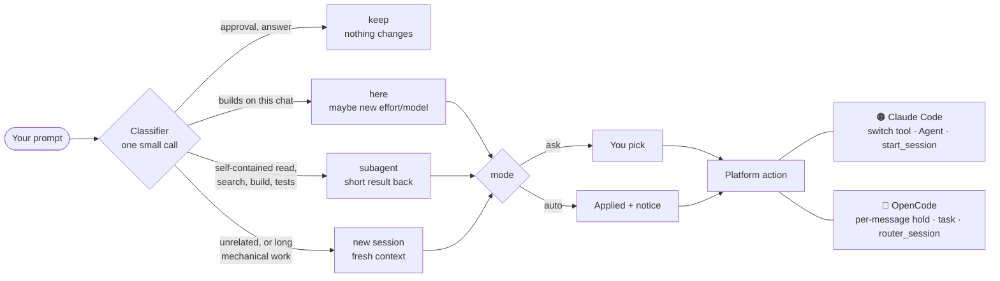

<div align="center">

# 🧭 Prompt Router

**The right place, the right model and the right effort for every prompt, decided before the agent starts working.**


<br>


<sub>Unit tests: Claude Code 190 · OpenCode 70</sub>

[How it works](#how-it-works) •
[Quick start](#quick-start) •
[Compare](#compare) •
[Concepts](#concepts) •
[Claude Code](#claude-code) •
[OpenCode](#opencode) •
[FAQ](#faq) •
[Development](#development) •
[Changelog](#changelog)

</div>

---

> Every reply in a long chat re-reads the whole context. Opus on a rename burns money. Haiku on a race condition burns time.

Prompt Router makes **one small classifier call per prompt** (none for a plain `yes` or `option 2`). Before any work starts, it tells the agent where the prompt belongs and which model and effort it needs. You stay in control: every change is offered first, unless you tell it to just do it.

<table>
<tr>
<td width="25%" align="center">🔀<br><b>Where</b><br><sub>this chat, a subagent or a new session</sub></td>
<td width="25%" align="center">🧠<br><b>Model</b><br><sub>small, mid, big, or the top one for the rare hardest cases</sub></td>
<td width="25%" align="center">🎚️<br><b>Effort</b><br><sub>low, medium, high, xhigh, max</sub></td>
<td width="25%" align="center">🙋<br><b>You decide</b><br><sub>a question by default, or <code>auto</code></sub></td>
</tr>
</table>

<a id="how-it-works"></a>
## 🧩 How it works



The classifier sees:
- the new prompt (only the text you typed),
- the chat's first and last few prompts,
- the start of the agent's last reply,
- the current model, effort and context size.

When a prompt does not belong in this chat, the agent asks before it starts (here in Claude Code):

```
╭─ Prompt Router ─────────────────────────────────────────────────────╮
│ Where should this go? It is an unrelated feature, so a fresh        │
│ session fits.                                                       │
│                                                                     │
│   › New session (Sonnet · medium)      ← recommended                │
│     Subagent (Haiku · low)                                          │
│     Do it here (Low)                                                │
│     Do it here (keep Medium)                                        │
╰─────────────────────────────────────────────────────────────────────╯
```

When the prompt stays here but needs more or less thinking, you get **Switch / Keep as is**. With `effortDetection: auto` it just switches and tells you:

```
Effort: Low (was Medium), small follow-up to the last fix
```

On a new chat's **first prompt** it also checks the model: Opus picked for a rename? Haiku for debugging? It offers the switch (or makes it, with `firstChatDetection: auto`).

Plain replies to the agent pass through untouched with **no classifier call at all**: up to five words that are each a yes / no / ok / thanks / go on word (English, Czech, Spanish, German, French: `yes, go on`, `ano, pokračuj`, `sí, hazlo`, `díky`), `option 2` / `možnost 2`, a number or a single letter (`3`, `b`). A reply with any word of its own (`yes, but use Postgres`) or a re-work sign (`still wrong`) goes to the classifier as usual. Other answers to the agent's questions, slash commands and prompts where nothing needs to change pass through untouched too.

> [!NOTE]
> **Architecture.** [`plugins/prompt-router/core/router.ts`](plugins/prompt-router/core/router.ts) holds the shared logic: the classifier prompt, parsing its reply, the routing rules. [`hooks/register.tsx`](plugins/prompt-router/hooks/register.tsx) (Claude Code) and [`adapters/opencode/`](adapters/opencode) only wire it to each platform.

<a id="quick-start"></a>
## 🚀 Quick start

| Agent | Install | Then | Full guide |
| --- | --- | --- | --- |
| 🟠 **Claude Code** | `/plugin marketplace add Viktorooos/prompt-router`<br>`/plugin install prompt-router@prompt-router` | Open a new chat | [Claude Code](#claude-code) |
| 🔵 **OpenCode** | `git clone https://github.com/Viktorooos/prompt-router.git`<br>`node prompt-router/adapters/opencode/install.ts` | Restart OpenCode | [OpenCode](#opencode) |

<a id="compare"></a>
## 📊 Feature comparison

The decisions are the same everywhere. What each platform lets a plugin do differs.

| | 🟠 [Claude Code](#claude-code) | 🔵 [OpenCode](#opencode) |
| --- | --- | --- |
| **Runs as** | a mod (plugin) | a plugin |
| **Covers** | desktop app, CLI, VS Code, Remote Control | CLI / TUI and desktop |
| **Switches effort** (`auto`) | ✅ | ✅ per-message hold; can change mid-turn |
| **Switches model** (`auto`) | ✅ | ✅ from the next message |
| **Ask mode** | ✅ dialog | ✅ question tool (text if missing) |
| **Subagent** | ✅ Agent tool with model and effort | ✅ `task` with a `router-<tier>` subagent |
| **New session** | ✅ `start_session` in the app; ⚠️ a `claude …` command elsewhere | ✅ `router_session` tool (fallback: an `opencode` command) |
| **Model check on first prompt** | ✅ | ✅ |
| **Here on another model** (later prompts) | ✅ asks Subagent or Stay here | ✅ asks Subagent (`task`) or Stay here |
| **Notice** (`auto`, `notifications`) | toast + footer label | toast |
| **Savings stats** (`stats`) | `/router stats` (table + page with a graph), saving in the footer | `router_stats` tool (text table) |
| **`/router` command** (lists every option and where it came from) | ✅ | ✅ config command + toast |
| **Default classifier** | Sonnet | `anthropic/claude-sonnet-5-5` |
| **Options live in** | `~/.claude/settings.json` (`pluginConfigs`) or `/plugin` | `~/.config/opencode/prompt-router.json` or `opencode.json` |
| **Status** | used daily | ⚠️ unit-tested only, never run live |

<a id="concepts"></a>
## 🧠 Concepts

Shared by all three platforms.

### Decisions

| | When |
| --- | --- |
| **keep** | An approval or an answer to the agent's question. Nothing changes. |
| **here** | Builds on what this chat already read or changed, is trivial, or the chat is still small. |
| **subagent** | A self-contained search, read, build or test run whose short result is needed here. |
| **session** | Unrelated to this chat, or long mechanical work better done with a fresh context. In a chat over **60k tokens**, even a trivial unrelated task goes here. |

**Here on another model** (all three platforms). The chat's model is set only on its first prompt. Later, switching it would break the prompt cache and the new model would read the whole context again at full price. So when a prompt belongs here but fits a stronger or a cheaper model, the router asks: **Subagent (model · effort)**, which gets what it needs from the chat and returns a short result, or **Stay here**, where only the effort is judged again (`effortDetection`). With `midChatModelDetection: off` it only judges the effort.

### Models

The router thinks in four tiers. Each platform maps them to its own models. In OpenCode the mapping is yours: any provider, mixed if you like (cheap tiers on one, strong ones on another).

| Tier (OpenCode) | Claude Code | For | Claude price (in / out per 1M) | OpenCode default |
| --- | --- | --- | --- | --- |
| **`light`** | Haiku | Running, reading, searching, short answers | $0.10 / $0.50 | `anthropic/claude-haiku-5-5` |
| **`standard`** | Sonnet | Mechanical edits by an existing pattern | $2 / $10 | `anthropic/claude-sonnet-5-5` |
| **`strong`** | Opus | New logic, debugging, review, anything risky | $4 / $20 | `anthropic/claude-opus-5-5` |
| **`top`** | Fable | Only where Opus at high effort is likely not enough | $10 / $50 | `anthropic/claude-fable-5-1` |

<a id="fable"></a>
<details>
<summary><b>When Fable is offered</b></summary>

Fable is rare on purpose.

- ✅ A new architecture across several layers with no clear solution.
- ✅ A hard concurrency or security problem whose reach is unknown.
- ✅ A bug two fixes already failed to solve.
- ✅ A deep analysis where a wrong conclusion costs a lot.
- ❌ Never for an everyday feature (however big), a code review, payments or a migration with a known approach.

It is offered only when your platform has it:
- Claude Code: your model picker lists it.
- OpenCode: a provider lists `models.fable`, or the chat runs on it.

</details>

### Effort

| | For |
| --- | --- |
| **low** | Simple work |
| **medium** | The default |
| **high** | Where a hidden mistake costs money, data or trust |
| **xhigh** | Long critical work you hand off (overnight, over the weekend) |
| **max** | Only when you ask for the maximum, or a one-off irreversible step with a very high cost of a mistake (production data, a live security incident) |

Words like *important*, *carefully* or *do it properly* never raise it beyond **high** on their own.

<a id="options"></a>
### Options

The same keys on every platform. Each feature has its own switch. The defaults keep the behaviour of 0.7.

| Option | Values (default first) | What it does |
| --- | --- | --- |
| `project` | text (empty: a software project) | What your chats are about, in a few words. |
| `rules` | text (empty) | Your own routing rules. They win over the built-in ones. |
| `language` | `auto`, or a language name | The language of the reason and of the questions. `auto` uses each prompt's language. |
| `classifier` | `sonnet`, `haiku`, `opus`; in OpenCode the tiers `standard`, `light`, `strong` | The model tier that makes the call. Haiku (`light`) is cheaper and less accurate, Opus (`strong`) the most accurate and expensive. |
| `effortDetection` | `ask`, `auto`, `off` | The effort for a prompt that stays here. `ask`: a question first. `auto`: just switch. `off`: never touch the effort; "Do it here" and "Stay here" have no level. |
| `firstChatDetection` | `ask`, `auto`, `off` | The model on a new chat's first prompt. `ask`: a question first. `auto`: just switch. `off`: keep the model. |
| `midChatModelDetection` | `ask`, `auto`, `off` | A later prompt that stays here but fits another model. `ask`: offer Subagent or Stay here. `auto`: no question; the agent uses the subagent only for a larger self-contained job that needs the other model, keeps a quick question or short answer here (the effort judged as `effortDetection` says) and tells you in one sentence what it chose. The chat's model never changes. `off`: judge only the effort. |
| `subagentSuggestions` | `ask`, `auto`, `off` | `ask`: offer a subagent for a self-contained task. `auto` (Claude Code): no "Where should this go?"; the subagent starts right away and the agent says so in one sentence (Claude Code also shows a toast with `notifications: on`). It covers the other-model offer too while `midChatModelDetection` is `ask`; with `midChatModelDetection: auto` the agent still decides itself. A new-session offer still asks. In OpenCode `auto` works like `ask`. `off`: the prompt stays here (effort and the other-model offer still apply). |
| `sessionSuggestions` | `ask`, `off` | `ask`: offer a new session for an unrelated task. `off`: the prompt stays here. |
| `newSessionAt` | `50%`, `off`, `40%`, `60%`, `70%` | Once the chat holds this share of its model's context window, any prompt that would stay here is offered as a new session, a follow-up too: every reply re-reads the whole context. The reason says how full the chat is. In Claude Code the window is cut to where the chat compacts (`CLAUDE_CODE_AUTO_COMPACT_WINDOW`, `CLAUDE_AUTOCOMPACT_PCT_OVERRIDE`). `off`, or `sessionSuggestions: off`: never. |
| `notifications` | `on`, `off` | `on`: a toast after an automatic change, and a footer label in Claude Code. `off`: none of these; the changes still happen. |
| `compareWith` | `opus-medium`, any `<model>-<effort>` (`haiku`, `sonnet`, `opus`, `fable` × `low` … `max`), `first`, `history` (Claude Code) | What the [savings stats](#savings-stats) compare with. Default Opus at medium effort (Anthropic's pick for everyday work), the same for every chat. `first`: the model the chat started on (the main chat's for a subagent), the behaviour before this option. `history`: the mix of models and efforts you ran before installing the router, weighted by tokens (see [savings stats](#savings-stats)). Claude Code; OpenCode always uses `first`. |
| `stats` | `on`, `off` | Claude Code. `on`: note each decision and each turn's token use in a local file for [savings stats](#savings-stats). `off`: nothing is noted. Default `on`. |
| `openPane` | `off`, `on` | Claude Code. `on`: the Prompt Router pane opens by itself when a session starts (shown from 144 terminal columns, 110 once you have opened it with `/router panel`), or else on your first prompt. `off`: only `/router panel` opens it. |

Where to put them:

| Platform | File | Key |
| --- | --- | --- |
| 🟠 Claude Code | `~/.claude/settings.json`, or `/plugin` → prompt-router → Configure | `pluginConfigs` › `prompt-router@prompt-router` › `options` |
| 🔵 OpenCode | `~/.config/opencode/prompt-router.json`, or the plugin's options in `opencode.json` | top level |

`/router` shows the value of every option and where it came from: set, an old key, or the default. Each session also writes them once to the log.

> [!NOTE]
> **Old names still work.** Before 0.8.0 there were two keys. `effortMode` (`ask`, `auto`) is now `effortDetection`. `modelMode` (`ask`, `auto`, `off`) is now `firstChatDetection`, and `modelMode: off` also turns off `midChatModelDetection`, as it did in 0.7. An old key counts only when the new key is missing. `/router` tells you to rename it.

> [!TIP]
> Want no questions about effort or model at all? Set `effortDetection` and `firstChatDetection` to `auto` and `midChatModelDetection` to `off`. "Where should this go?" is still asked; to stop it, set `subagentSuggestions` and `sessionSuggestions` to `off`.

### Your own rules

`rules` is plain text appended to the classifier's prompt, and it wins over the built-in rules. Write it like a note to a colleague:

```
Database migrations: opus, high.
Translating finished Compose screens to SwiftUI: sonnet, medium.
Payments, vouchers, auth: opus, high.
Copy changes on the marketing site: haiku, low.
```

Name the tier either way: `haiku`/`sonnet`/`opus`/`fable` or `light`/`standard`/`strong`/`top`. OpenCode maps it to your models.

### Accuracy and cost

Last live eval: **123 cases**, including the Fable / xhigh / max boundaries. `test/cases.json` now has 132; the 9 newer cases have not been run live yet. How to run it: [Development](#development).

| Classifier | Result |
| --- | --- |
| Sonnet, 3 runs | ✅ 369 / 369 |
| Opus | ✅ 123 / 123 |
| Haiku | ⚠️ 114 / 123 (none of the misses raised a tier) |

One classifier call per prompt (none for a plain reply such as `yes` or `option 2`): low effort, at most 150 output tokens, on the model you pick in `classifier`. With the default Sonnet in Claude Code, that is a fraction of a cent per prompt. The savings come from not running a 200k-token chat on a question that needed a fresh one.

<a id="savings-stats"></a>
### Savings stats

`/router stats` shows Today / 7 days / Total and writes a page with a bar graph of the last 30 days (`~/.claude/mods-logs/prompt-router-stats.html`; open the `file://` link it prints). The footer shows today's net saving next to the model and effort (`notifications: on`).

It is an **estimate**, kept honest:

- Each turn's tokens (input, output, cache read and write) are priced with the list prices in [`core/prices.ts`](plugins/prompt-router/core/prices.ts), the only place with prices.
- **Compared with** `compareWith`: by default every turn's tokens are priced on **Opus at medium effort** as well (shown as *Cost on Opus medium* and *Balance vs. Opus medium*), so a chat that started on Haiku and was escalated is not counted as a loss against Haiku. With `compareWith: first` it is the model the turn would have run on without the router (the model you picked for the chat; for a subagent the router offered, the main chat's model). The log keeps the tokens, so a new choice reprices the old data too.
- **History** `compareWith: history` (Claude Code): compares with what you really ran before the router. Once, in the background (it never holds a prompt or the session's start), `scripts/history-scan.mjs` reads the transcripts in `~/.claude/projects/*/*.jsonl` older than the first record of the stats log, streamed and only the assistant replies, and adds up their tokens per model and effort (a transcript with no effort counts as medium). Plain Node, no model calls; on about 6 GB of transcripts it took 5 s. The result is kept in `~/.claude/mods-logs/prompt-router-history.json` and never recomputed (delete the file to count again). Each turn is then priced on every part of the mix, for example 75 % Opus high, 15 % Opus extra high, 5 % Opus max, and the prices weighted by the shares. Until the count is done, or with no sessions from before the router, it compares with Opus medium and `/router stats` says so; `/router`, `/router stats` and the panel show the mix.
- **Saved** = the same tokens on that model minus what they cost. With a fixed `compareWith` (the default `opus-medium`) every turn counts, also a subagent the router did not offer (for example the built-in Explore on Haiku): the number says what the work cost against always running on that model, not only what the router itself moved. With `first`, a subagent the router did not offer saves nothing.
- **Effort is not re-priced**: the prices do not depend on effort, only the number of tokens does, and how many tokens another effort would have made cannot be known from one turn. So what a lower effort saves is not counted; a subagent's turns are priced like any other turn.
- The **classifier's own cost** is taken off: **net saving** = saved − classifier.
- A **stronger model** the router picked is shown as **extra cost**, apart, never hidden in the net.
- A turn cut off before it finished has no token count in the log. `/router stats` (never a prompt or the panel) then reads its chat's transcript with `scripts/usage-scan.mjs` (plain Node, no model calls; only the chats with such a turn) and takes the tokens of the requests since the turn before; the panel counts it as unknown. A model with no price claims no saving.

The data stays on your machine: `~/.claude/mods-logs/prompt-router-stats.jsonl` (under `CLAUDE_CONFIG_DIR` when you set it), trimmed to 90 days and 5 MB. Parallel sessions append to it under a lock (`scripts/append.mjs`), so none loses another's records.

What one line of the log holds, and nothing more: **no prompt text, no replies, no file names or paths**.

- **decision**, one per routed prompt: time, platform, a random chat id (and the Claude Code session id), where it went (here / subagent / session / keep), the model and effort before and after, whether it was applied, asked or declined, how the prompt follows the last answer (continues / corrects / new), whether it reads as a redo, the classifier's model, tokens and time, and `key`: the first 16 hex digits of the SHA-256 of the prompt (lower case, spaces collapsed). The key only tells that the same prompt came again (a repeat counts as a failed task); it is not the text, though a very short, common prompt could be guessed by hashing candidates. Logs from before this change hold the prompt's first 200 characters in `key` instead; they still load, and an old key never matches a new one, so a prompt repeated across the upgrade is not seen as a repeat. Those lines leave the log with the 90-day trim.
- **turn**, one per finished turn (main chat or subagent): time, chat id, subagent id, the model and the model it would have run on, token counts, duration, effort, and whether you moved the picker yourself.
- **accept**: time, chat id and which decision you took or declined. Turn it off with `"stats": "off"`.

<a id="balance"></a>
### How the balance is worked out

The token estimate above assumes the work would have taken the same tokens without the router. It misses the cost of a cheap model that fails and has to be run again. So the panel, `/router stats` and the stats page also show a **balance per task**, still an estimate from the list prices:

- **Task** = a routed prompt plus the prompts that continue or fix it (the classifier says which; the same words again go on with it), ending at a new topic or after 30 min of quiet. Its turns include its subagents.
- **Balance of a routed task** = its turns priced on the model they would have run on without the router (as in the token estimate) − what they cost. A negative number means the router cost you more. Effort is not re-priced.
- **Re-work**: when the task failed (you switched to a stronger model, repeated the prompt, corrected it or broke it off), its follow-up turns count as lost, weighted 1 / 1 / 0.7 / 0.4.
- **Parts**: cheaper picks, higher picks, re-work and the classifier, which comes off every task.
- **`~`** marks a rough number: fewer than 12 routed tasks.
- **Accuracy** = the share of routed tasks without a failure, with a 95 % (Wilson) interval.
- A repeated prompt (redo) counts as a correction. Declined offers are logged and shown as *Asked / declined*.

Records from development builds of 0.10.0 with the fields `holdout`, `trial` or `wanted` still read: those fields are ignored and such a prompt counts as a keep.

---

<a id="claude-code"></a>
## 🟠 Claude Code

### Requirements

Claude Code with mod (plugin) support: the desktop app, the terminal CLI, VS Code or Remote Control.

### Install

```
/plugin marketplace add Viktorooos/prompt-router
/plugin install prompt-router@prompt-router
```

Open a new chat and type as usual. Optionally set `project` so its calls fit your work.

### Options

Set the [options](#options) in `/plugin` → prompt-router → Configure, or in `~/.claude/settings.json`:

```json
"pluginConfigs": {
  "prompt-router@prompt-router": {
    "options": {
      "project": "a React web app and a React Native mobile app for sharing recipes, Node.js backend",
      "rules": "Database migrations: opus, high. Copy changes on the marketing site: haiku, low.",
      "language": "English",
      "effortDetection": "auto",
      "firstChatDetection": "auto",
      "notifications": "on"
    }
  }
}
```

> [!IMPORTANT]
> Options are read when a session starts. After a change, open a **new chat**.

| Command | What it does |
| --- | --- |
| `/router` | Status, this chat's model and effort, and whether the router holds the effort |
| `/router off` | Turn it off (remembered across sessions) |
| `/router on` | Turn it back on |

### Differences

Claude Code is the reference platform. Notes per client:

- In the desktop app, **New session** uses `start_session`. Where the chat cannot start a session itself (terminal, VS Code), you get a `claude --model … --effort …` command to run in a new terminal.
- `claude -p` and Agent SDK runs pass untouched: their flags already chose the model and effort.

<details>
<summary><b>How switching works under the hood</b></summary>

- After **Switch** or **Do it here (…)**, Claude changes this chat's model or effort through the mod's own `switch` tool, because Claude Code's session tools refuse the chat they run in.
- `switch` refuses a model this chat is not offered (e.g. Fable when your picker does not list it) and says what it skipped. If it fails, Claude tells you the `/model` or `/effort` command to run.
- Where the effort setting cannot be changed, the router puts the level on each request until you move the effort picker yourself.
- A prompt typed while a turn is running keeps the model and effort.
- The model is switched only on a chat's first prompt. Where the app has no model setting to change, the router puts the model on each request: the picker may still show the old model, while `/router` and the footer label show the one in use.

</details>

### Uninstall

`/router off` for a while · `/plugin` → prompt-router → Disable · or:

```bash
claude plugin uninstall prompt-router@prompt-router
```

---

<a id="opencode"></a>
## 🔵 OpenCode

For the OpenCode CLI / TUI and desktop.

> [!WARNING]
> The OpenCode adapter is **unit-tested only** (74 tests with a mock client). It has not been run against a real OpenCode yet.

### Requirements

- OpenCode with the V1 plugin API (`@opencode-ai/plugin` 1.19.x).
- `@opencode-ai/plugin` available in `~/.config/opencode` (OpenCode installs it there).
- A clone of this repo. The shim loads the plugin from it, so keep it where it is.

### Install

```bash
git clone https://github.com/Viktorooos/prompt-router.git
node prompt-router/adapters/opencode/install.ts
```

Restart OpenCode to load it. The installer writes:
- a shim, `~/.config/opencode/plugins/prompt-router.ts`, that re-exports the plugin from the repo. A file it would overwrite is kept as `prompt-router.ts.bak-<time>`.
- `~/.config/opencode/prompt-router.json` with the defaults, when there is none.

### Options

The [shared keys](#options) plus the OpenCode ones, in **one** of two places:

1. **`~/.config/opencode/prompt-router.json`** (default). The shim in `plugins/` is auto-loaded, and OpenCode passes no options to auto-loaded plugins.
2. **`opencode.json`**. Move the shim out of `plugins/` (else it loads twice) and list it with its options. These then win and the JSON file is not read.

<details>
<summary><b>Example files and OpenCode-only keys</b></summary>

`~/.config/opencode/prompt-router.json`:

```json
{
  "classifier": "standard",
  "effortDetection": "ask",
  "firstChatDetection": "ask",
  "midChatModelDetection": "ask",
  "subagentSuggestions": "ask",
  "sessionSuggestions": "ask",
  "newSessionAt": "50%",
  "notifications": "on",
  "project": "",
  "rules": "",
  "language": "auto",
  "models": { "light": "anthropic/claude-haiku-5-5", "standard": "anthropic/claude-sonnet-5-5", "strong": "anthropic/claude-opus-5-5", "top": "anthropic/claude-fable-5-1" },
  "variants": { "low": "low", "medium": "medium", "high": "high", "xhigh": "xhigh", "max": "max" }
}
```

Other providers, or a mix, work the same way. Effort names differ per provider, so check `variants` too:

```json
"models": { "light": "openai/gpt-6-luna", "standard": "openai/gpt-6.1-terra", "strong": "anthropic/claude-opus-5-5", "top": "openai/gpt-6-astra" }
```

`opencode.json`:

```json
"plugin": [["file:///Users/<you>/.config/opencode/prompt-router.ts", { "effortDetection": "auto", "timeoutMs": 20000 }]]
```

| Key | What it does |
| --- | --- |
| `models` | The `provider/model` for each tier, from any provider (old keys `haiku`…`fable` still work) |
| `variants` | The model variant (`provider.<p>.models.<m>.variants.<name>`) for each router level; `""` uses the model's default |
| `timeoutMs` | The classifier's time limit (plugin options only; default 20000) |

</details>

`/router off` / `on` is kept in `~/.config/opencode/prompt-router/state.json`, next to the log `prompt-router.log` (also sent to OpenCode's own log). The classifier runs in a throwaway session with no tools, deleted afterwards.

### Differences

- **A switch is a per-message hold.** A plugin cannot move the picker. The router puts the variant (and model) on each message until you move the picker yourself; the picker in the UI does not move.
- **Effort** can change mid-turn (through `chat.params`). The **model** changes only from the next message.
- **Subagents** `router-light`, `router-standard`, `router-strong` and `router-top` are added through the config hook. The agent calls `task` with one of them, and the router sets its effort.
- **New sessions** start through the `router_session` tool (open them with `/sessions`). If it fails, you get an `opencode --model … --prompt …` command.
- **`/router`** is a config command: the agent answers with the status, plus a toast.
- **`top`** is offered only when a provider lists its model or the chat runs on it.

### Uninstall

```bash
node prompt-router/adapters/opencode/install.ts --uninstall
```

Removes the shim (only if it is the router's) and puts back the newest file it replaced. Your options file stays.

---

<a id="faq"></a>
## ❓ FAQ

<details>
<summary><b>It asks me even though I set <code>auto</code>.</b></summary>

- Options are read when a session starts, so open a new chat.
- Run `/router`. It lists every option, its value and where it came from. The log has the same line for each session, with the folder of the copy that wrote it.
- In Claude Code, put them under the full id `prompt-router@prompt-router` in `pluginConfigs`. An entry under plain `prompt-router` is used only when there is no full-id entry, and `/router` tells you to rename it.
- Check that no second copy of the mod runs (`claude plugin list`, and any dev copy under `~/.claude/dev-mods/`). A copy without your options falls back to `ask`.
- A later prompt that stays here but fits another model always asks **Subagent** or **Stay here**, also in `auto`: the chat's model never changes mid-chat. In `auto` the question has one **Stay here** option, and the new effort is set when you pick it.

</details>

<details>
<summary><b>Why does it offer a subagent for a prompt that belongs to this chat?</b></summary>

The prompt fits another model than this chat runs on, a stronger or a cheaper one. Switching this chat's model would make the new model read the whole context again at full price, so the router offers a subagent on that model instead. The subagent does not see the chat: Claude passes it what it needs and gets back a short result. **Stay here** keeps the model and only adjusts the effort. A greeting, an approval, a quick question or a short message stays here without asking.

</details>

<details>
<summary><b>Why didn't it suggest a new session when I changed topic?</b></summary>

Questions and opinions about what this chat is already doing stay here: the answer is short and builds on the context. Once the topic turns into a new piece of work, the router offers a session.

</details>

<details>
<summary><b>It never offers Fable.</b></summary>

Fable is offered only when your platform has it, and only for the rare cases in [When Fable is offered](#fable). Everyday features, reviews and known migrations go to Opus.

</details>

<details>
<summary><b>Can I use it with the Effort Optimizer mod?</b></summary>

Use one of them, not both: they both set effort per prompt.

</details>

<a id="development"></a>
## 🧪 Development

### Unit tests

Canned classifier replies, no model calls. From the repo root:

```bash
claude plugin test plugins/prompt-router       # Claude Code mod: 190
claude plugin validate plugins/prompt-router   # manifest and options check
node --test adapters/shared/test/              # tier names: 6
node --test adapters/opencode/test/            # OpenCode: 70 (mock client)
```

### Live eval

Shared by all platforms. In a Claude Code session with the mod loaded, ask Claude to run the `mcp__prompt-router__test` tool with:
- `file` = the absolute path of `plugins/prompt-router/test/cases.json`
- `runs` = `3`
- `out` = a TSV path

Then:

```bash
python3 -I plugins/prompt-router/test/eval.py <out.tsv>
```

Cases can override `project`, `rules`, `language`, `classifier` and `models` (e.g. without `fable`). `template` takes a classifier prompt file, so you can tune the rules without reloading the mod. `eval.py` also lists cases that waver between runs.

### Where things live

| File | What lives there |
| --- | --- |
| [`core/router.ts`](plugins/prompt-router/core/router.ts) | Shared by all platforms: the classifier prompt (`TEMPLATE`, `FABLE_RULE`), parsing, the routing rules |
| [`core/prices.ts`](plugins/prompt-router/core/prices.ts) | Model prices per 1M tokens (the only place with prices) |
| [`core/stats.ts`](plugins/prompt-router/core/stats.ts) | Savings stats from the log: summary, per day, text table, page |
| [`hooks/register.tsx`](plugins/prompt-router/hooks/register.tsx) | Claude Code wiring: the dialogs, the `switch` tool, `/router`, the stats log |
| [`adapters/opencode/`](adapters/opencode) | `install.ts`, `prompt-router.ts` (the plugin) |
| [`test/router.test.ts`](plugins/prompt-router/test/router.test.ts) | Unit tests with canned classifier replies |
| [`test/cases.json`](plugins/prompt-router/test/cases.json) + [`expected.json`](plugins/prompt-router/test/expected.json) | Live eval cases and the right answers |
| [`.claude-plugin/plugin.json`](plugins/prompt-router/.claude-plugin/plugin.json) | Version and option definitions |

> [!TIP]
> Keep the classifier prompt in flat one-line bullets. Nested bullets inside a rule shifted Sonnet's calls on unrelated cases in the eval.

<a id="changelog"></a>
## 📜 Changelog

| Version | Changes |
| --- | --- |
| **0.10.0** | Savings are an estimate from list prices only. Declined offers and repeated prompts (redo) are logged; a redo counts as a correction in the balance per task. A task's cost includes its subagents and the classifier. Cut-off turns get their tokens from the chat's transcript (`scripts/usage-scan.mjs`, only in `/router stats`). Effort is no longer re-priced by a guess. OpenCode logs the same task fields (prompt key, follows, redo, accepted and declined offers). A plain reply (`yes`, `ok`, `option 2`, a number or a letter, in five languages) keeps the prompt with no classifier call, on all platforms. The stats log keeps no prompt text, only a hash of it. Claude Code: parallel sessions no longer lose stats or log lines; the config folder comes from `CLAUDE_CONFIG_DIR`, `HOME` or `USERPROFILE`. |
| **0.9.2** | Panel: folds stay open after a settings change; no effort button for `compareWith: history`. |
| **0.9.1** | `compareWith: history`: the savings compare with the models and efforts you ran before the router, weighted by tokens, counted once from the transcripts. New option `compareWith`: the savings compare with Opus medium by default, any other model and effort, or `first` (the chat's first model, as before); old data is repriced from its tokens. `subagentSuggestions: auto` starts the suggested subagent with no question and says so in one line (Claude Code). |
| **0.9.0** | Savings stats on both platforms. Claude Code: `/router stats` (Today / 7 days / Total, and a page with a graph of the last 30 days) and today's net saving in the footer. An estimate from list prices: the classifier's cost is taken off, a stronger model is shown as extra cost apart, effort only as counts. OpenCode: `router_stats` tool. New option `stats`. |
| **0.8.0** | One switch per feature: `effortDetection`, `firstChatDetection`, `midChatModelDetection`, `subagentSuggestions`, `sessionSuggestions`, `notifications`. The old `effortMode` and `modelMode` still work. `/router` lists every option and where it came from, and the log records them once per session. OpenCode: a prompt that stays here but fits another model offers a subagent on that model or staying here. `midChatModelDetection: auto` lets the agent choose between the two itself, with no question. OpenCode options name tiers (`light`, `standard`, `strong`, `top`) instead of Claude models; the old keys still work. OpenCode subagents are `router-<tier>`, and its questions show the real model. |
| **0.7.0** | Claude Code: a prompt that stays here but fits another model offers a subagent on that model or staying here; the chat's model never changes mid-chat (it would break the prompt cache) |
| **0.6.0** | OpenCode adapter (`adapters/`), the router logic moved to a shared `core/router.ts` |
| **0.5.1** | Options under the short key `prompt-router` are read (with a hint to rename it); the classifier sees only the typed text (the app's reminder blocks are stripped); `start_session` is offered only where it exists, the terminal gets a `claude --model … --effort …` command |
| **0.5.0** | Fable, xhigh and max with narrow rules; switching through the mod's own `switch` tool |
| **0.4.1** | Asks before changing model or effort; unrelated tasks in big chats go to a new session |
| **0.3.2** | Checks the model on a new chat's first prompt; eval of the whole router |
| **0.2.0** | First version: routes each prompt to this chat, a subagent or a new session |

## 📄 License

[MIT](LICENSE) © 2026 Viktor Kadeřábek
